# 电解液溶剂筛选中的描述符决策稳定性

## ——层级伪影、轴锁定分歧与筛查可用性：一个可审计的五通道漏斗

**数据版本**：v0.3.3（`data/dielectric_v03.csv`，246 行 × 38 列，SHA-256 `ff2142936e06e04b329b70f8597574f75349e54ce876e9fff81309e6d35ccce4`）  
**代码与交付版本**：GitHub release v1.11（2026-10-04）；第 21–47 周证据包见 `reports/decisions_log.md` 与 `成果输出/week21`–`week47`  
**许可**：数据 CC BY 4.0（`LICENSE-DATA.md`）、代码 MIT（`LICENSE`）  
**口径纪律**：本文出现的每一个 R²、每一个 τ_b 都标注它所属的池与电子结构层级。不同池、不同层级的读数永不相除、相加或互比；同一条读数在两处出现时，一律使用同一个冻结字面值。

## 摘要

**动机。** 电解液溶剂的筛选依赖三类可计算物性：静态介电常数 ε（决定锂盐解离与离子对行为）、粘度 η（决定离子电导与低温性能）、以及前线轨道能级 HOMO/LUMO 及其派生的氧化／还原电位窗口（决定正负极界面上的电化学稳定性）。这三类物性在公开文献中高度异质：温度口径不一、来源许可不清、冲突值被静默平均；轨道与氧化还原通道则几乎全部来自量子化学计算，泛函、基组、溶剂化模型与介质常数各异，口径混杂更重。更要紧的是，**当一条描述符的排序本身不稳定时，任何基于它的筛选结论都不成立**——而这一层风险在既有工作中通常既没有被量化，也没有被审计。

**数据。** 我们构建了一个含 246 种近室温（293.15–303.15 K）纯有机液体、38 个字段的静态介电常数数据集（v0.3.3），按来源分层收录（NIST ThermoML 归档 100 种、NBS Circular 514 210 种、开放获取综述表与一手文献补足至 246 种）。轨道与氧化还原通道另建，取公开可再分发的外部源：Batt-SLM 的 Batt-P30K（MIT 许可，29,519 个分子，ωB97X-V/def2-TZVPPD/SMD(ε=18.5) 级的 HOMO/LUMO/gap/EA/IP/偶极）与同源 Redox-Pot（393 行 IP/EA 与氧化还原电位）；并接入 QM9（CC BY 4.0，133,885 分子，B3LYP/6-31G(2df,p) 气相）作为第三个轨道与偶极外部**对照层**，名册命中 103 / 241。

**框架。** 我们把「描述符决策稳定性」落成一个**单变量台阶框架**：每上一级只改一个因素，于是「位移的符号与量级」与「排序的保真度」可以逐级归因。轴分两支——`P` 轴是自由分子的电子结构台阶（`P_0` Koopmans 轨道 → `P_1` ΔSCF → `P_2` 隐式溶剂），`C` 轴是条件态台阶（`C_0` 裸分子 → `C_1` `[Li(M)]⁺` → `C_2` `[Li(M)₂]⁺`）。判据在跑之前冻结（预注册），靶值置换必须使读数塌缩（安慰剂），同一化合物不得跨折（组内泄漏审计），失败必须写成交付物的一部分（负结果登记）。

**主结果一：决策稳定性本身可以被量化。** 在 246 化合物普查上，排序统计量 τ_b 的重抽标准差服从**有限总体修正**的闭式 `sd(N) = s0·sqrt(1/N − 1/N_pop)`（6 条实测曲线拟合 rmse ≤ 0.0086）。由此得到母体论文样本量档（N = 12）的**噪声地板 0.122**（六条曲线中位；均值 0.1212，区间 0.0862–0.1519）：任何小于约 0.12 的两档 τ_b 差异，在该样本量下不可读。这把「数据不足」从一句免责声明变成了一条可复算的读数。

**主结果二：还原轴上的跨工作分歧是层级伪影。** 在与母体论文同层可比的六个台阶上，**氧化轴三档的距离全部 ≤ 0.04σ**，**还原轴三档全部 ≥ 2.3σ**（2.32σ / 4.21σ / 6.80σ）且方向一致。把化合物固定、只移动电子结构层级（同一批 22 个化合物：GFN2-xTB ↔ ORCA r2SCAN-3c），**氧化轴 τ_b 只动 −0.043，还原轴 τ_b 由 +0.835 翻到 −0.602**，后者与母体论文的 −0.467 同量级。因此母体论文还原轴的「失序」不是化合物集合差异、也不是小样本抖动，而是 r2SCAN-3c 层级的真实行为；**本仓 246 普查在还原轴上给出的 +0.826 才是层级伪影**。机制同批可见：还原轴位移极差由 2.55 eV 涨到 11.97 eV（4.7 倍），气相阴离子不束缚占比由 0.764 升到 1.000。

**主结果三：排序统计量与筛查可用性是两件事。** 在 28 个台阶-轴上，τ_b 与 Top-10 重叠率的秩相关只有 +0.793，而**未解析占比与 Top-10 重叠率的秩相关是 −0.862**；到 Top-30 才趋同。有 4 个台阶-轴满足 `τ_b ≥ 0.50` 却 `Top-10 重叠 < 0.20`，全部落在 `C_0→C_1` 还原轴上。也就是说：**当未解析占比超过约 0.75 时，τ_b 即便还有 0.57–0.71，头部十名已经不可用**。

**主结果四：把纪律变成跑不过就报错的工件。** 态合法性从诊断升为盘上注册表（1,028 行）加同体守卫（合法子集 < 5 抛 `RedoxGateRefusal`，**不返回 None**）；引用登记表的 10 行标记全部由守卫给出而不是手写；端点判等容差冻结为 1e-12（发布值与现场复算值最多差 2 ulp）；四通道噪声地板（0.4737 / 0.4903 / 0.5828 / 0.3695）接进显示层。三条曾被判为「设计缺陷」的判据被改法救回，救回的是**问法**而不是数据：反解预算在 tau=30 上给出 `alpha* = 0.06`（10 条推荐守住 precision ≥ 0.90；tau=15 上反解为空，照实判否）；零命中的绝对阈值换成相对判据（十分位比 **0.6518**，p = 0.000）加指纹盲区判据（26 对，其中 4 对绝对 Δε ≥ 5）；比值判据在五个干净阶梯上给出 **21.04 / 13.71 / 8.09 / 4.18 / 7.27** 倍，AUC30 极差全部 < 0.02。

**主结果五：「缺的那一维」是分子间关联。** 结构-only 的 1-近邻只有 R² **0.2503**；指纹相似度与标签差的秩相关只有 **−0.0607**（z = −2.1630，p = 0.0260），「很像但差很大」的对数是 **0**；Kirkwood-Onsager 相对取向相关因子在给体域对非给体域的中位数比是 **2.5016**（z = 4.076，p = 0.0060），高介电族子群比 **15.650**。三者同向指向同一句话：**单分子描述符传不了分子间关联**。第三个轨道与偶极外部层（QM9）给出同一种「排序学会、量级学不会」的签名：间隙 ρ 0.8856 而中位数比只有 0.7058；偶极偏离的主因不是构象自由度（刚性域绝对 Δμ 中位数 0.4442 D 对柔性域 0.4205 D，**判否**），而是约 **0.39 D 的系统偏置**。

**关键词**：电解液溶剂筛选；描述符决策稳定性；电子结构层级；层级伪影；排序统计量；可审计机器学习；预注册；负结果登记

---

## 1 引言

### 1.1 三类物性、一个筛查问题

电解液设计的三类前置物性各有明确的物理角色。**静态介电常数 ε** 决定溶剂对锂盐的解离能力：ε 越高，离子对与离子簇越容易被拆开，自由载流子浓度越高。传统上 ε 被当作「连续介质」的宏观参数，但在分子尺度上它由偶极矩、构象分布与取向相关因子 g（Kirkwood 因子）共同决定，而 g 恰恰是**单分子描述符无法携带**的那一维信息。**粘度 η** 通过 Walden 关系与离子迁移率耦合，是低温性能与倍率性能的直接瓶颈；在本项目中，η 与 ε 被严格当作**两条互不相通的通道**，因为二者的观测量、池与门限都不同。**HOMO/LUMO 及其派生的氧化／还原电位窗口**决定溶剂在正负极界面上的电化学稳定性；这一通道的数据形态与前两者不同，主要来自量子化学计算（不同泛函、不同基组、不同溶剂化模型、不同介质常数）而非实验，因此口径混杂更严重。

需要强调的是本文的目标：**电解液溶剂的可审计筛选**，而不是把某一个物性预测得更准。这一取向决定了全文的口径选择、指标选择与拒答设计——也决定了我们为什么把大量篇幅放在「哪些结论不成立」上。

### 1.2 公开数据与公开模型的四类结构性问题

在构建数据集与复算轨道通道的过程中，我们反复遇到三类**结构性**的数据问题与一类**方法学空白**。

1. **温度口径不齐。** 同一化合物在不同温度下的 ε 差异可达数个单位；文献中的「25 °C」有时是 293.15 K、有时是 298.15 K、有时只是「室温」。不做温度协调，跨来源比较就会引入系统性偏差。
2. **许可与可再分发状态不清。** 大量数值来自不支持再分发的出版商汇编或综述表，混入「开放数据集」会在二次分发时制造法律风险；反过来，把 MIT 许可的 Batt-P30K 与 CC BY-NC 4.0 的 THEMol 混用，同样会污染交付物的法律状态。
3. **冲突值被静默平均。** 当两个一手来源给出不同数值时，最常见处理是取平均——这会同时抹掉数值差异与它携带的方法学信息，并使该行不可审计。在轨道通道上，这条问题的对应物是**把不同泛函／基组／溶剂化模型的数值混进同一个池**。
4. **描述符的「决策稳定性」从未被量化。** 前三类问题都追问「这个数对不对」；但筛选真正依赖的是「这个描述符能不能把候选排对」。当一条描述符的排序本身不稳定时——换一个电子结构层级、换一个配位条件、或样本量不足——任何基于它的筛选结论都不成立。既有工作通常既不报告排序统计量的不确定度，也不做跨层级的排序对照，于是「数值精度」被当成了「决策可靠性」的代理。本文把这一空白变成一个可测量、可定位、可操作的读数。

此外还有一条我们后来才意识到的问题：**「查不到」与「被挡住」被混为一谈**。一个数值可能有确定来源、只是该来源当前不可访问；把它记成「缺失」会系统性地低估数据集的真实覆盖。本文对此的处理是显式区分两者，并对不可访问来源登记其可达性结论。

在「排序统计量」这一层，本批文献已有先例：Korth 等（2014）与 Rathnakumaran 等（2026）分别把 Kendall τ 用于跨方法一致性比较、并指出单解释变量在电解液溶剂筛选中会失效。本文不与这些工作在「谁先用了秩相关」上竞争——**本文的定位是纪律、判据与拒答**：把 τ_b 的不确定度、适用域与「不可判定」写成可执行断言，并把失败登记成交付物的一部分。换言之，本文的贡献不是「首次用秩相关」，而是「在秩相关已经被用过之后，给出失效发生时怎么读、怎么拒、怎么复算」。更近的一步来自跨领域：Abaei 等（2026）已在 MOF 领域把「ranking 与 regression 分离」当成独立课题处理，Deng 等（2026）亦在溶剂化描述符上报告同类分歧——「描述符决策稳定性」的修辞框架正在扩散，**抢占生态位的窗口在收窄**。

### 1.3 本文工作与贡献

本文在一份 246 化合物普查上，围绕上述四类问题给出五组可复算的读数与一套工程化纪律：

- 用**来源分层收录 + 冲突记录而不平均 + 被挡不等于缺失**三条口径，把 246 行数据集做成逐行可回溯的规范表；
- 用**单变量台阶框架**（`P` 轴与 `C` 轴）把「位移」与「排序」分开归因，并在与母体论文可比的六档上给出轴锁定的 σ 距离；
- 用**有限总体修正的抽样误差律**把「数据不足」本身变成读数，得到母体论文样本量档的噪声地板；
- 用**同化合物、同几何、同源项、只换层级**的对照，把跨工作分歧的原因定位到电子结构层级，并配套给出机制读数（位移极差与阴离子不束缚占比）；
- 用**可执行门禁、预注册、安慰剂与负结果登记**把上述纪律固定成交付物的一部分，使「口径漂移」在复算时直接报错。

---

## 2 数据与方法

### 2.1 数据来源与分层收录

介电常数数据集 v0.3.3 含 246 种近室温（293.15–303.15 K）纯有机液体、38 个字段，按来源分三层收录：NIST ThermoML 归档（100 种）、NBS Circular 514（210 种）、开放获取综述表与一手文献（补足至 246 种）。每一行都记录其来源、表页与温度口径。轨道与氧化还原通道独立建池，只取公开可再分发的外部源：Batt-P30K（MIT，29,519 分子）、Batt-SLM Redox-Pot（393 行）与 QM9（CC BY 4.0，133,885 分子，仅作对照层）。THEMol（CC BY-NC 4.0）只保留在原始目录、不进入交付包；Reaxys 数值不进入任何池、特征或交付物。

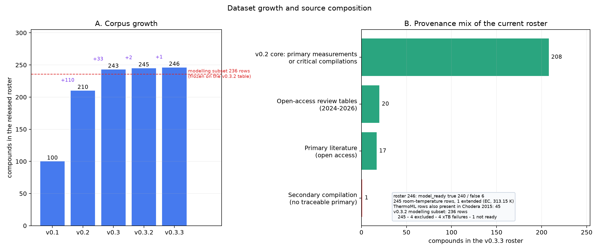

### 2.2 冲突处理与扣留规则

面对冲突值时，我们的规则是**记录而不平均**：保留双值与该行的方法学标签，并在下游显式扣留，而不是取均值制造一个没有出处的「精确数」。v0.3.3 中共有 6 行带冲突或不可核实标记，全部扣留而非静默删除。「被挡住不等于查无此值」这条口径用于处理来源可达性：一个有确定出处、但当前不可访问的数值，记为「被挡」并登记可达性结论，而不是记为缺失。

### 2.3 建模子集、特征表示与基准协议

**建模子集。** 规范表提供 236 行建模集，划分为两类协议：数据集级基准用 RepeatedKFold（5×10），筛选记分牌用 GroupKFold by InChIKey（5 折 × 10 次、seed 42）。**两种口径永不混比**：数据集级基准衡量「同族内插」，化合物分组口径衡量「跨化合物外推」，后者才是筛选场景的口径。

**特征表示。** 三族表示：Morgan 指纹（2048 维稀疏）、13–15 列物理描述符块、以及二者混合。物理块是全部后续优化的主战场。

**指标。** 数据集级基准报告 R² 与 Spearman ρ（原尺度）；筛选记分牌只报告排序类指标（AUC(ε>15)、AUC(ε>30)、Spearman、Top-K 富集）与覆盖／成本，**明令禁止**把 R² 当作漏斗 KPI（理由见 §3.8）。

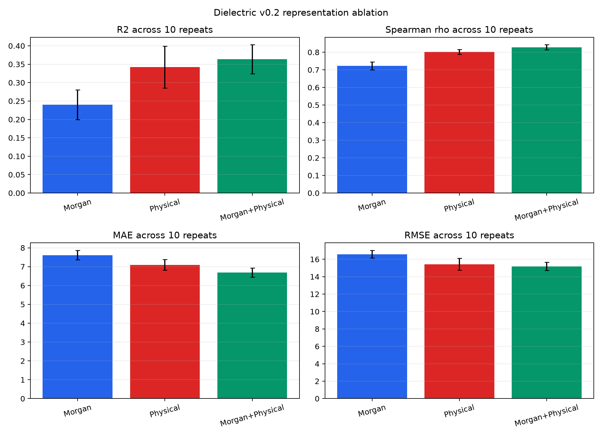

### 2.4 单变量台阶框架：`P` 轴与 `C` 轴

框架的核心是「每上一级只改一个因素」，使位移与排序可以逐级归因。轴分两支：

- **`P` 轴（自由分子电子结构台阶）**：`P_0` Koopmans 轨道 → `P_1` ΔSCF → `P_2` 隐式溶剂。每级只改电子结构层级或溶剂化处理。
- **`C` 轴（条件态台阶）**：`C_0` 裸分子 → `C_1` `[Li(M)]⁺` → `C_2` `[Li(M)₂]⁺`。每级只改配位条件。

排序保真度统一用 Kendall 型排序统计量 `tau_b` 度量，方向约定在全文一致。**同一台阶上位移的符号与量级**和**排序的保真度**被分开报告，因为二者可以背离（§3.15）。

### 2.5 预注册、安慰剂、泄漏审计与可执行门禁

四条纪律在跑之前冻结：

- **预注册**：判据、门限与「判词由哪一支臂决定」都在看到结果前写死；网格内读数更高的旁臂不得事后当选。
- **安慰剂**：靶值置换后，读数必须塌缩到预先写死的判据之下；未塌缩时照实登记、不得引用为塌缩证据。
- **泄漏审计**：同一化合物不得跨折；跨折化合物数必须为 0。
- **可执行门禁**：把纪律写成「跑不过就报错」的工件——态合法性注册表、引用登记表、端点判等容差（1e-12）、已废弃数字黑名单。

### 2.6 五通道筛选管线与出口物

筛选用五段式定义：候选源 → 域规则 → 排序键 → 拒答队列 → 出口物。五条通道为 ε、η、轨道、氧化还原、安全（熔沸点／闪点）。出口物不只有「入选候选」，还包括域外拒答名单、每条标签的溯源记录，以及被证否的负结果清单。**在役**与**晋升**是两种不同状态：本文只有一支臂被评为「有界达标」（§3.5），其余读数一律标注为诊断、边界或后验。

---

## 3 结果

### 3.1 数据集构成与主基准

规范表 v0.3.3 含 246 行、38 列，其中 236 行进入建模集。在**数据集级协议**（RepeatedKFold，5×10）下，三种表示的 R² 分别为 Morgan **0.2402**、物理块 **0.3422**、混合 **0.3636**；Spearman ρ 分别为 0.7223、0.8021、0.8282。物理块单独优于 Morgan，混合表示的增益主要来自物理块（图 2，见 §2.3）。这一档数字只回答「同族内插能不能拟合」，不回答筛选问题——后者一律走化合物分组口径。

### 3.2 目标变换、骨架留出与域间隙

**目标变换。** 把目标换成 `log(ε−1)` 后，三种表示在原尺度回评的 R² 为 0.1867 / 0.2898 / 0.2928，MAE 明显改善（6.273–7.321 对 6.686–7.612），物理块的 Spearman ρ 跃升到 **0.8795**。这印证了「排序学会了、量级学不会」的结构：变换压平了右偏尾巴，改善的是中低 ε 区与整体序关系，而非高 ε 尾部的量级。

**骨架/簇留出。** 用环系 Murcko 骨架加无环分子的 ECFP4 聚类构造平衡折（112 个唯一骨架，最大骨架 31 个化合物，五个划分种子各 5 折）。结果：Morgan R² **0.1383**（ρ 0.5970）、物理块 **0.2678**（ρ 0.7466）、混合 **0.2953**（ρ 0.7565）。从随机折到骨架折，R² 跌幅分别为 −0.10 / −0.07 / −0.07，而 ρ 只从 0.72/0.80/0.83 降到 0.60/0.75/0.76。**量级对「换一类骨架」极敏感，排序相对稳健**——这是把筛选任务重新定义为排序问题的第一处实验证据。

**域间隙外部平价。** 用一个冻结的旧版模型去预测 29 种新引入的电池溶剂：现代强极性溶剂落在旧模型域外，其中碳酸丙烯酯（PC）预测 **21.6** 而实测 **64.9**、碳酸乙烯酯（EC）预测 **33.7** 而实测 **90.5**。这不是模型「差」，而是训练语料里根本没有这一族。

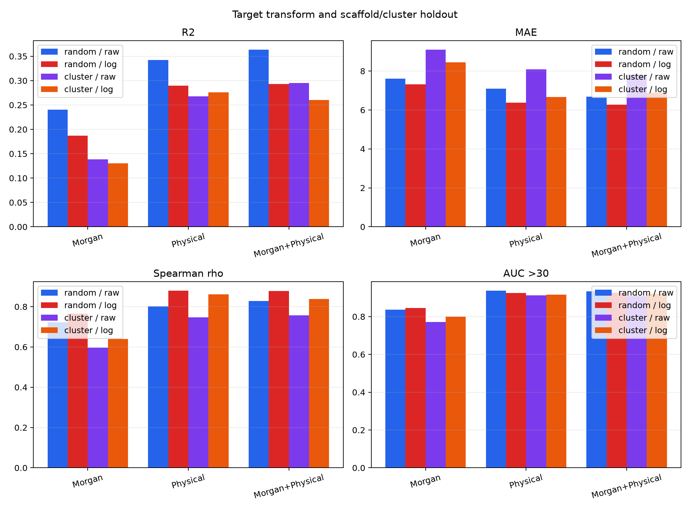

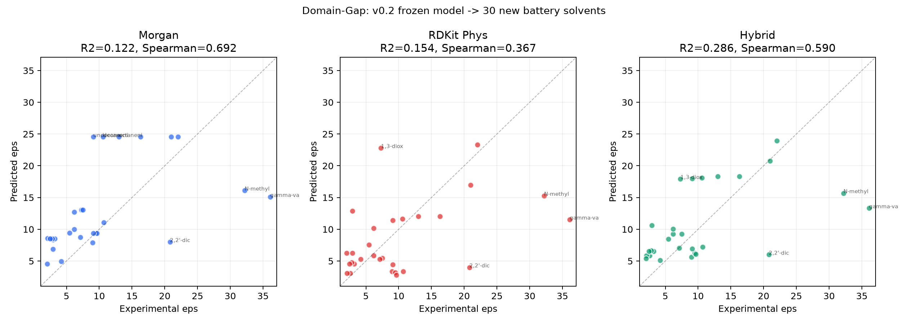

### 3.3 适用域、分层共形与温度协调

**适用域规则 D1（极性质子性溶剂）**：`NumHDonors(SMILES) ≥ 1` 且 `TPSA ≥ 20.0`。五个种子上：**全域 R² = 0.4540**（`0.45401075998423623`，池 457 行 / 97 化合物）、**D1 域内 R² = 0.5240**（`0.524012313223719`，池 297 行 / 57 化合物）、**D1 域外 R² = 0.3198**。另两条域规则的域内读数为 0.4220（D2）与 0.5395（D3，增益 +0.0854）。**口径纪律**：域内读数是「范围声明下的第二块记分牌」，不得替换或提升为主记分牌读数，全域数必须与域内数同时报告。

**分层共形。** 名义 90% 的共形区间在边际上成立（覆盖率 0.915），但一旦分层到 ε > 60，覆盖率崩塌到 **1.5%–26%**。这是一个必须报告的负结果：**边际覆盖率合格并不意味着尾部可用**，而电解质设计恰恰关心尾部。

**温度协调。** 对 NBS Circular 514 这一层，我们刻意不引入一个「看起来更好」的拟合，而是估计**系统误差的上界**：用可解释参数 α 协调来源内部的温度依赖后，报告残余偏差的包络。这样做牺牲了名义精度，但避免了把温度不齐伪装成模型误差。

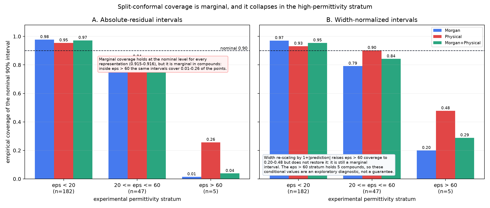

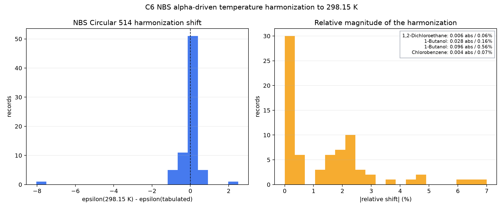

### 3.4 受控消融：加入 PC/EC 究竟值多少

一个典型的「未经控制的增益」案例。早期版本的对照实验声称把 PC 与 EC 加入训练集能给混合表示带来 **+0.056** 的 R² 提升。改用**配对实验**（相同折、相同种子、只改训练集）后，受控增益为 **+0.0059**（*p* = 0.110），统计上与零无法区分。结论：**「数据加进来就有提升」这类结论必须用配对设计去测**，否则折的随机性会被记成增益。

### 3.5 ε 主记分牌与「有界达标」

这是全文口径最复杂的一段。全部读数都在**同一块记分牌**上：池 457 行 / 97 化合物 / 276 个（化合物, T）对，GroupKFold by InChIKey、5 折 × 10 次、seed 42，指标为原尺度 R²，端点取多种子均值。

**冻结的三个锚点。**

**表1　冻结的三个锚点（ε 通道）**
| 读数 | 值 | 含义 |
| --- | --- | --- |
| 冻结基线 | `0.4091179943351143` | 未被改写的可比性锚点 |
| 冻结头条 | `0.4766400383507876` | 混合表示 + 杠杆 4 + 杠杆 8；相对基线 +0.0675 |
| 单表示诚实端点 | `0.5861142332208197` | 五种子均值；单个种子（42）为 `0.6080587938801277` |

注意第三个锚点的两重身份：**0.6080 是单种子读数，0.5861 才是它的跨种子均值**，二者不可互换。

**第 20 周的晋升。** 一个**预先注册**的单臂 ε 二段精调把跨种子均值推到 **`0.6216672295270079`**（≥ 0.60），五种子下界 **`0.5999547508973201`**（> 0.55），两项同时成立 ⇒ `gate_met = true`、判词 `promoted`。逐种子均值为 0.5999547508973201 / 0.6218233838892735 / 0.6202090430932049 / 0.6395023798932657 / 0.6268465898619755。注册臂为 `hp2_d4_n200_lr0.05_mcw5_ss0.8_cs0.8_bin128`。注册机制：当年冻结的深度 2 是为 2048 维稀疏 Morgan 定的，而胜出的物理块只有 13–15 列稠密特征，深度 2 等于每棵树 4 个叶节点、几乎必然欠拟合；事前写下的诚实预期是 +0.01 ~ +0.05，并明确标注为判断而非实测。

**纪律比读数更重要。** 网格内读数**更高**的旁臂（`…mcw5…bin64`，跨种子均值 **0.6249509650342622**）**没有**被用来改判——判词只由那一个预注册臂决定，其余 8 支臂 × 5 种子 = 40 个读数只作附带信息交付。这是本工作与「调参调到过线为止」之间最实质的区别。

**三项审计。** ① 锚点逐位复现：seed 42 的 `xgb_reference` 复现 `0.6080587938801277`，绝对偏差 0.0（容差 1e-9）；② 泄漏审计：50 折 × 5 种子，跨折化合物数 **0**；③ 安慰剂：置换靶值后同一注册臂的跨种子均值塌缩到 **0.41179237661783363**（下界 `0.37675835219632026`），低于 0.60 门限也低于同臂真实均值 ⇒ `collapsed = true`。

**账务规则。** 该臂记为本周 **1** 次主记分牌尝试、**累计 12** 次；冻结头条与基线**不因它而改写**。新读数是一条带适用条件的新事实，不是对旧读数的事后修订。

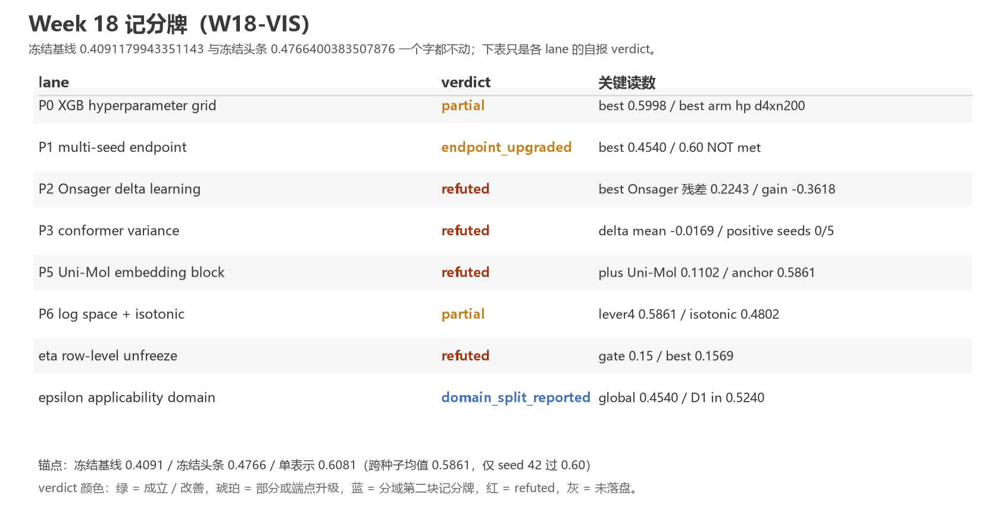

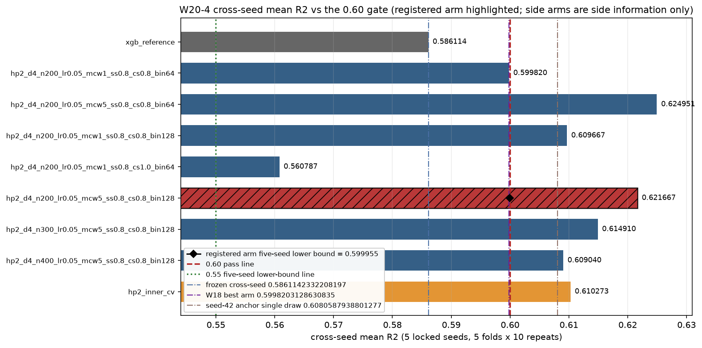

### 3.6 把 0.6217 拆开：单键定价、交互面与两个后续配置点

注册臂跨过 0.60 是事实，但它的**单键定价不是空白**。先纠正一条容易混的口径：不能说「三键同动、无法归因」——单键定价在 W20-4 就已做完，后续轮次增加的是**新配置点、交互面与一条方法论负结果**。

**（一）W20-4 网格内的单键定价**（同池、同表示、同 5 折 × 10 重复、同五个种子）：

**表2　W20-4 网格内的单键定价**
| 键 | 变化（其余保持基线） | 基线读数 | 变体读数 | 单键增量 |
| --- | --- | --- | --- | --- |
| `max_depth` | 2 → 4 | 0.5861142332208197 | 0.5998203128630835 | **+0.0137060796422638** |
| `min_child_weight` | 1 → 5 | 0.5998203128630835 | 0.6249509650342622 | **+0.0251306521711787** |
| `max_bin` | 64 → 128 | 0.5998203128630835 | 0.6096666055899116 | **+0.0098462927268281** |
| `colsample_bytree` | 0.8 → 1.0 | 0.5998203128630835 | 0.5607871938382311 | **−0.0390331190248524** |

因此「是哪一项在起作用」在 W20 就有答案：`min_child_weight` 是四键里最大的一项，`max_bin` 单独也足以过门（0.6097 ≥ 0.60），而 `colsample_bytree` 的方向是**负的**。注册臂把 mcw 与 bin 叠加后是 0.6216672295270079，**低于 mcw 单项的 0.6249509650342622**，也低于二者的可加性预测 0.6347973——**键之间不正交，存在负交互**。

**（二）W27（负结果）：安慰剂不惰性。** 把 W26 算出的 13 列 ddCOSMO 介电响应量接在稠密块之后，五种子增量 **−0.096956**，确认线与部分线双判否。更值钱的是把同一块的行顺序打乱后增量仍有 **−0.006099**（惰性线 0.005）：在 13–15 列的稠密块上再接 13 列，**哪怕不含真实信息，读数也会掉约 0.006**；因此净信息效应是 **−0.090857**，余下 0.0061 是容量效应。

**（三）W28（两枪）：有更好的配置，但选择器挑不中。** 第 1 枪把超参选择搬进外层折内部，五种子增量 **−0.014899**（仅 1/5 种子为正）⇒ 判否。机制读数比读数本身更值钱：内层选择在 250 个外层折里选出深度 3 共 **110 次（44.0%）**，而深度 3 恰是固定阶梯上**最差的两档**之一——**选择器系统性地偏好诚实阶梯上最差的那一档**。第 2 枪（固定档位阶梯）最佳档位 `deep_d4_n200_lr05` = **0.5998203128630835**，与 W20-4 网格里的 `bridge` 臂（即 W18 最佳臂）**逐位相同**：这既是过程交叉验证，也说明该读数不是新发现。

**（四）W29（新配置点）：分箱增益依赖深度。** 把 `max_bin` 64 → 128 用在**深度 2** 上带来 **+0.017053221078764724**（五种子均值 **0.6031674542995844**，4/5 种子为正），而同样只动这一个键、在**深度 4** 上只有 **+0.0098462927268281**——分箱增益依赖深度，几乎差一倍。另两个键在深度 2 上同样是负的：`colsample_bytree` 0.8 → 1.0 掉 −0.0478040823597，`reg_lambda` 1.0 → 0.1 掉 −0.0795315855694289。加密到 256 桶只多 0.000134，增益在 64 → 128 之间**已经饱和**。W29 的 0.6031674542995844 **低于** mcw 单项，也低于注册臂，因此它是**新配置点**而不是新纪录——**首次过门仍是 W20-4**。

**（五）合起来的账。** 到 W29 为止，**四键都已有单独读数**，「未定价」不再是任何键的状态。若要继续，面对的是**组合与交互面**，而不是单键。

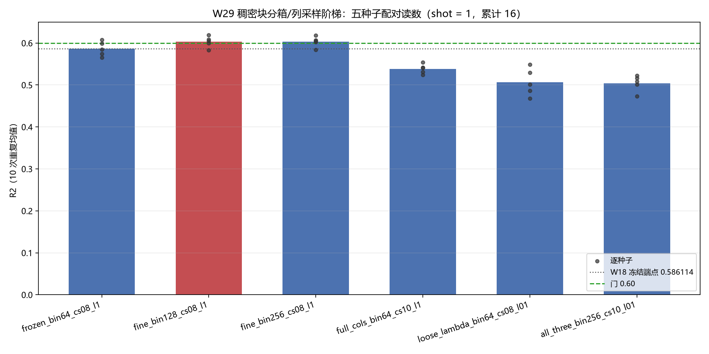

### 3.7 组合与交互：第 30 周的六档阶梯

单键定价闭合之后，最后没被问过的是**组合**。第 30 周用同一套代码路径预注册六档固定配置（前三档复现锚，后三档新组合点），**四条复现锚全部逐位命中**：seed 42 冻结档位 0.6080587938801277、冻结档位五种子端点 0.5861142332208197、深度 2 + `max_bin` 128 的 0.6031674542995844、以及 §3.5 的注册臂 0.6216672295270079（gap 全部恰好 0.0）。最佳新组合 `0.6170832198249109` 比第 29 周最佳高 **+0.013915765525326473**，但**没有**超过注册臂。

真正的增量是机制：注册臂里的**深度那一项只值 +0.0045840097020970**，`min_child_weight` 的边际值近似配置无关，而 `max_bin` 的强依深度、`reg_lambda` 两侧都是负的。同一条零成本的后验分解把 §3.8 的诊断做成了受控对照。

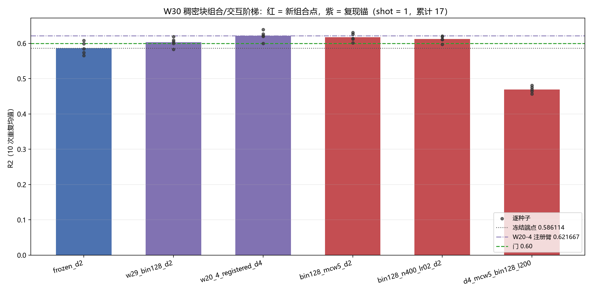

### 3.8 排序学会了、量级学不会：漏斗 KPI 定板

在化合物分组口径下，把漏斗 KPI 分成两组，并**明令禁止**把 R² 当作漏斗 KPI：

- **排序类**：`auc_gt15`、`auc_gt30`、`spearman`、`top_k_enrichment`；
- **覆盖与成本类**：可评分化合物数、域内覆盖率、每候选计算成本。

**定板读数（合并池）**：`auc_gt15 = 0.8947205768486257`、`auc_gt30 = 0.9392420870425322`、Spearman `0.7737616891926036`、Top-20 精度 **0.95**，基础发生率 `0.26258205689277897`，相对富集 3.4275 / 3.6179 / 2.5135（Top-10/20/50）。

**为什么禁止 R²。** 因为诊断结论是「排序学会了、量级学不会」：R² 量的是量级，AUC 量的是排序。把 R² 放进漏斗会让你因为一个与筛选目标无关的量级误差而误判整条管线。

**受控分解。** 第 28、29 周的固定阶梯本来就是同表示、同折、同种子、只动超参的配对实验，其逐重复表带着 `spearman` / `auc_gt15` / `auc_gt30` 列。于是可直接读出：**第 28 周阶梯六档的 R² 档位间极差是 0.1170，同一批档位的 AUC(ε>30) 极差只有 0.0056（比值 21.0）；第 29 周阶梯是 0.0989 对 0.0072（比值 13.7）。** 换句话说，**在同一块表示上，超参能挪动 R² 的幅度是它挪动 AUC 的 13.7 到 21.0 倍**——量级可调，序几乎是超参不变量。同一条分解还给出稀疏 Morgan 块的**相反失败方式**：冻结时它的 AUC(ε>30) 只有 0.4972（≈ 抛硬币），重调后升到 0.7193（+0.2222），而 R² 仍停在 0.0211。因此两种表示族的失败可以分开陈述：**稠密物理块是「序已满、量级不足」；稀疏 Morgan 块是「给了容量才能排序，而量级始终没起来」。** 这条分解是后验读数，不占 shot，也不替换任何冻结读数。

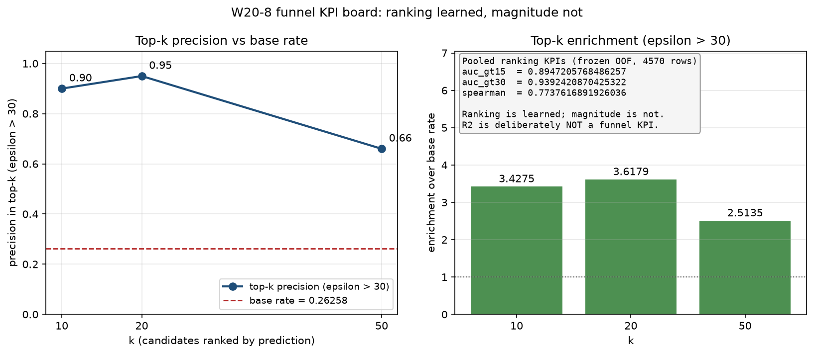

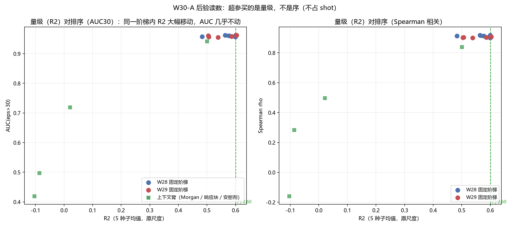

### 3.9 η 通道：全漏斗里离过门最近的一处

η 通道与 ε 通道**完全独立**：它有自己的池、自己的门、自己的口径。第 20 周做了一次**公平性复核**，回答「在役 η 预测器是真的差，还是只是没给够预算」。

设计：两侧给同一套组外协议（GroupKFold by InChIKey，5 折 × 5 次重复），在役臂补齐它从未得到过的最强预算（三配置网格 + 只训练行的内部折选择 + 三种子集成）。

**行级池（4,151 行 / 976 键；合并测试 20,755 行）**：Chemprop **0.1054414994165841** 对在役 **0.15963939692814613**（就地复现绝对偏差 0.0），Δ = **−0.05419789751156204**，门限 0.15、容差 0.02，三种子分别为 −0.055427 / −0.054354 / −0.052812，全部超过容差 ⇒ 判词 `eta_crosses_gate_out_of_fold`，即**学习模型确实穿过门限，在役臂没有**。**族级池（3,582 行 / 957 键）**：Chemprop **0.1014586835798006** 对在役 **0.1471395849716971**，**两侧都过 0.15** ⇒ 判词 `incumbent_budget_closes_gate`。主判词只看行级池，族级作为第二块读数同时报告。

**两项照实登记的瑕疵。** ① 本 lane 的安慰剂**未塌缩**（网格 MAE 0.3952143564868206 对常数组内预测器的 0.39910182316678505），登记为「单侧塌缩检查、本次未塌缩」，不得当作塌缩证据引用；② 该 lane 不晋升、不占 shot 编号、对主记分牌贡献 0 次。

**读数含义。** 在役族的门读数 0.1748 对门限 0.15 只差 0.025，行级读数 0.1569 只差 0.0069。这意味着 **η 通道是全漏斗里离「过门」最近的一处**，且行级解冻路径已经具备。这是一个典型的「低垂果实」式机会，与 ε 通道的封顶困境形成对照。

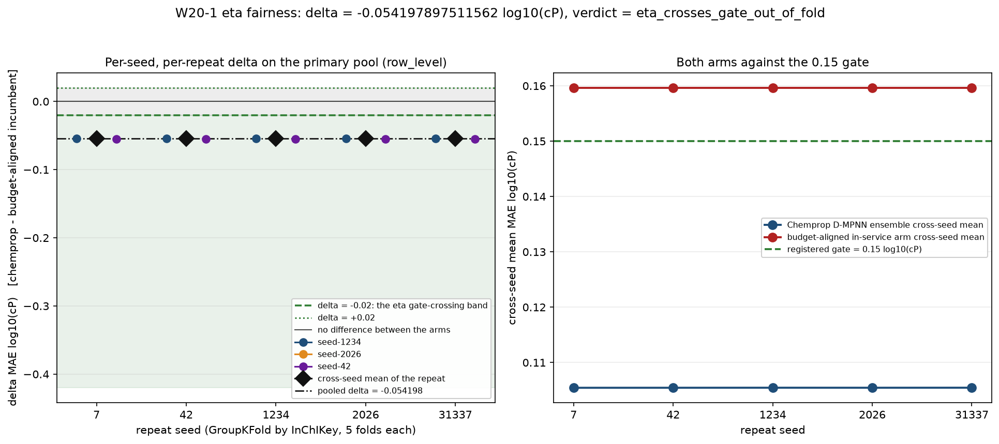

### 3.10 高 ε 区正式拒答、物性空间与安全通道

**拒答规则。** 高 ε 区（注册表 31,949 行口径）有 75.7% 的行被拒答（拒答率 `0.757085020242915`）。短期看是覆盖率损失，长期看是把不可判定样本从静默错误里救出来。物性空间（ε、η 与轨道窗口）被适用域交集切成不连通的小块，候选区域随之碎片化。

**安全通道。** 熔沸点与闪点共用 186 行、281 维特征（Morgan 计数 r2 256 + 25 个 RDKit 描述符），ExtraTreesRegressor(300) 在 GroupKFold by InChIKey 下得到组键 MAE：熔点 24.97767123875773 K、沸点 25.395136749805708 K、闪点 18.93154740989103 K，基线分别为 40.645869505093216 / 51.918480354950496 / 41.417524232531726 K，全部安慰剂塌缩（48.36 / 59.37 / 47.20 K）。**该通道可建模，但不晋升。** 标签溯源用一个封闭的四角色词汇表加 11 行 sidecar，把每条标签通道归到来源，覆盖 **34,131** 个键（密度 2,178、介电 247、液窗 218、轨道 29,868、氧化还原标签 392、粘度 1,228）。

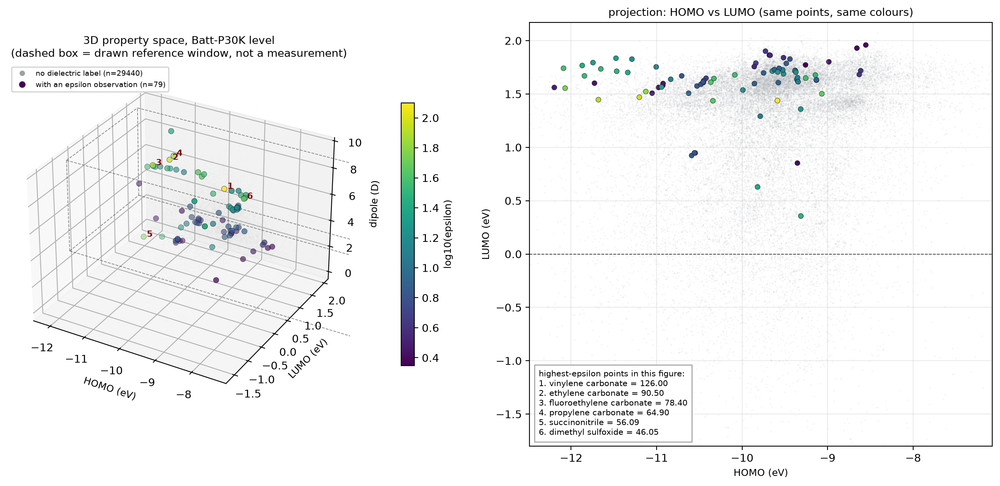

### 3.11 化合物上限封顶与负结果清单

**封顶修订。** 一条被证伪的阶梯前提：若「把化合物覆盖翻倍」能带来 0.58–0.65 档的读数，那么加大收录就是合理的投资方向。实测结果是开放许可化合物名册**上限 161、当前 153**（最宽口径），净新增上界仅 **+4** 种化合物，状态标为 `capped`。三条独立的上限突破探针全部为负：Org-Mol 溯源裁定 `inadmissible`；NBS-514 转录得到 636 行 → 名册命中 121 → 候选 28 → 可用 26（25 个唯一连通块），三关全过但 `ceiling_break = false`；CEP 88k 源判定 `not_identifiable`、`licence_verdict = not_verifiable`，归入 Tier C。

**结论：靠扩大化合物覆盖把 R² 推过 0.60–0.65 档的路径被证伪；在现有许可与物理约束下，0.70 没有路径。**

**表3　把 R² 推过 0.60–0.65 档的候选方向及其结果**
| 方向 | 结果 |
| --- | --- |
| 换拟合器 | GPR 0.2313、MLP −0.172 |
| 网络叠加 / bagging | +0.00175（惰性） |
| 外来化学空间（NBS-514 扩展） | 反噬至 0.3809 |
| 杂类锚点 | 反噬至 0.5102 |
| 表示侧杠杆（杠杆 6 之外） | 系统性证否 |
| ECFP 块在杠杆 4 配置下 | 净有害（5/5 种子成立，Δ 均值 +0.0445） |

**与参照文献的对标（六条可证伪维度）。** 对标只在方法学维度上做，不在数值上做。

**表4　与参照文献的六维方法学对标**
| 维度 | 参照工作 | 本工作 |
| --- | --- | --- |
| 标签可重放 | 代理模型输出，不可逐条复算 | 规范表逐行可复算 |
| 每行出处 | 无逐行定位 | DOI／表页定位 + 四角色 sidecar（覆盖 34,131 键） |
| 域声明 | 无 | 全域 0.4540／域内 0.5240／域外 0.3198；拒答 0.7571 |
| 通道数 | 3（熔点／沸点／闪点） | **5**（ε／η／轨道／氧化还原／安全） |
| 负结果 | 无 | 在册并落章 |
| 候选出口 | 133,885 → 29，仅结构相似度 | 115,756 → 候选附域声明 + 溯源 + 通道出处 |

**不得反向对标。** 参照工作在熔沸点与闪点上报告了更大的标签规模与更小的 MAE，那是其**通道禀赋**的产物，不是方法优劣。本仓不做跨通道的数值比较。**一处必须承认的落后**：参照工作把「生成新候选分子」做成了闭环，本工作的出口只有排序与拒答；原因是多目标同时条件化会撞塌多样性，且化合物名册受开放许可封顶在 153。

### 3.12 条件态轴：Li⁺ 配位的两级台阶

轨道这一支的 `C` 轴刻画「分子在电解液真实条件（被 Li⁺ 配位）下」的电子结构。第一配位壳 `C_0 → C_1`（裸分子 → `[Li(M)]⁺`）：配位后 HOMO 与 LUMO 同时下降，位移量远大于介质台阶，但**排序保真度很差**——在 Koopmans 口径下，这是全部 28 个台阶-轴里最不保序的一对（氧化轴 τ_b **0.459**、还原轴 **0.204**，n = 237）。换到 ΔSCF 口径后，`C_0 → C_1` 的氧化轴 τ_b 上升到 0.693（气相）/ 0.758 / 0.750 / 0.795，还原轴 0.566 / 0.686 / 0.669 / 0.707。

第二配位壳 `C_1 → C_2`（`[Li(M)]⁺` → `[Li(M)₂]⁺`）：氧化轴位移在气相为 **−1.4776 eV**、还原轴 **+1.2088 eV**，四档介质下符号稳定，τ_b 落在 0.755–0.869。这把框架的 `C_2` 槽位从「未执行」推进到「已实例化」。

**七条判否（照实登记）。** H1（还原轴的两级台阶失序）判否——τ_b = +0.566 与 +0.707，而母体论文为 −0.4667，论文的「还原轴失序」在两级台阶上都没有复现。H2（还原时多出的电子半数落在 Li 上）判否——达到 0.5 e 的占比仅 `c_1` = **0.340**、`c_2` = **0.258**（阈值 0.50；母体论文 11/12，但那是 N = 12 且为 Li⁺ 配位挑选过的体系）。H4、H5、H9 同样判否。**成立的条目**：H3（`sigma` 闭式恒等式，z = 1 与 1.96 两档最大差 0.0）、H6（N = 10 重抽 2000 次的 τ_b sd 落在 0.0986–0.1731）、H7（回归锚 219 对，最大绝对差 5×10⁻¹¹ Hartree）、H8（反式 2:1 几何完好 208/208/199/201，阈值 0.70）。

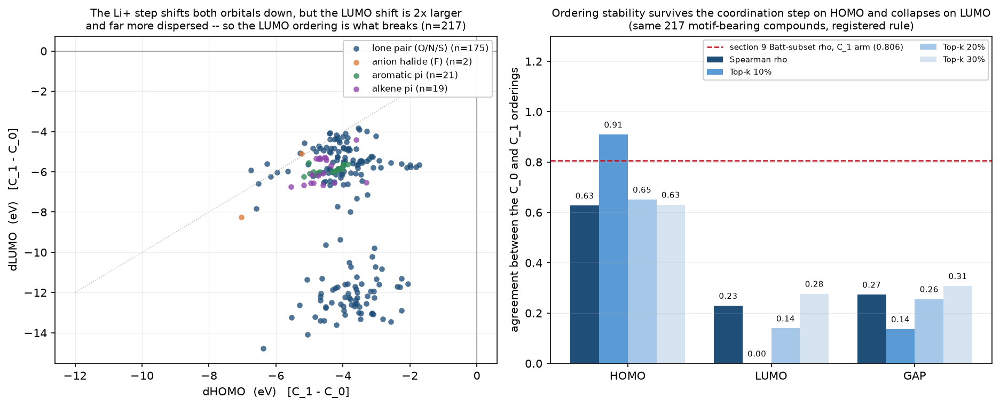

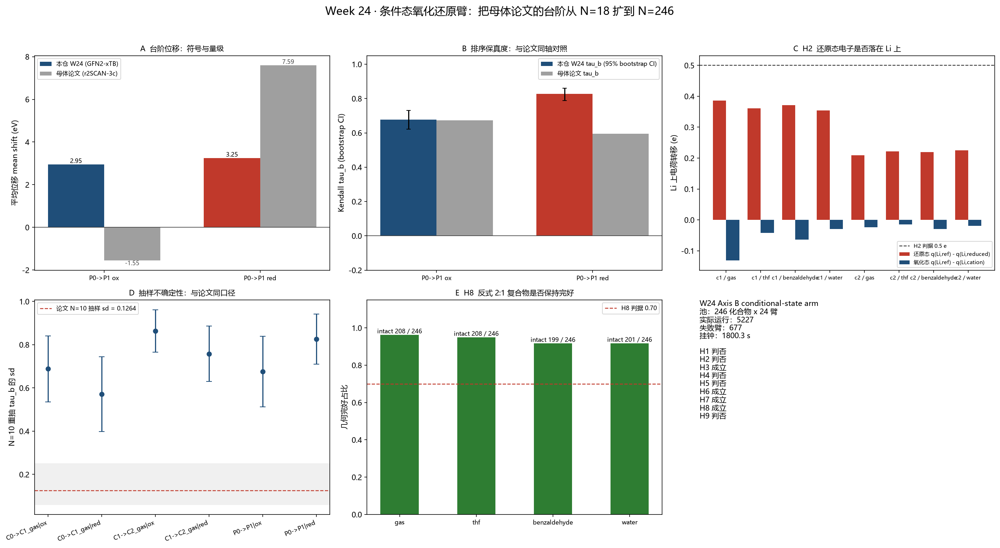

### 3.13 环境台阶与轨道介质阶梯

**轨道介质阶梯（ALPB 三档）。** 246 个化合物 × 8 臂 = **1,968 次 GFN2-xTB**，三档介质为 thf（ε = 7.58）、benzaldehyde（ε = 18.0）、water（ε = 80.4）。自由态下，`dHOMO` 均值为 +0.0320 / −0.0534 / −0.0377 eV，`dLUMO` 均值为 +0.0527 / −0.0404 / −0.0090 eV。三条结论：

1. **介质位移是二阶效应**（H3 成立）：`var(medium)/var(gas) = 0.0168`，而同批化合物的 `C_1` 配位位移是 0.1745——差一个数量级。这是「每级只改一个因素」在轨道轴上的直接体现。
2. **介质不保序**（H4 判否）：`ρ(gas, medium)` 在六条曲线上的下界仅 **0.816**，恒式阈值 0.90 未达。
3. **「介质使 HOMO 上移、LUMO 下移」这一常识不成立**（H1 判否，占比 0.0000），且位移不随 ε 单调（H2 判否，严格递增占比 0.0321）。对筛选叙事很关键：**不能用「介质越强、轨道越稳」这种单调直觉去预筛**。

**电荷态台阶（ΔSCF，四介质）。** 246 个化合物 × 12 臂 = **2,952 次 GFN2-xTB**，四介质各自优化中性态、阳离子态与阴离子态（**绝热口径**）。

**表5　电荷态台阶（ΔSCF，四介质）的 IP/EA 读数**
| 介质 | n(IP) | IP 均值 / eV | IP sd | EA 均值 / eV | EA sd |
| --- | --- | --- | --- | --- | --- |
| gas | 238 | 13.3825 | 2.2060 | 0.4709 | 3.1241 |
| thf | 238 | 11.4251 | 2.1342 | 2.3336 | 3.1266 |
| benzaldehyde | 238 | 11.5895 | 2.0907 | 2.3446 | 3.1364 |
| water | 238 | 11.1248 | 2.0920 | 2.7677 | 3.1051 |

四条结论：溶剂化降低 IP（H1 成立，三档均 ≥ 0.90，实测 0.9958）、溶剂化提高 EA（H2 成立，1.0000）、**但 |dIP| 不随 ε 递增**（H3 判否，0.0462）、**且气相阴离子多数不束缚**（H4 成立：0.7801 → 水相 0.3320）。最后一条是本文后续所有还原轴讨论的物理根源。

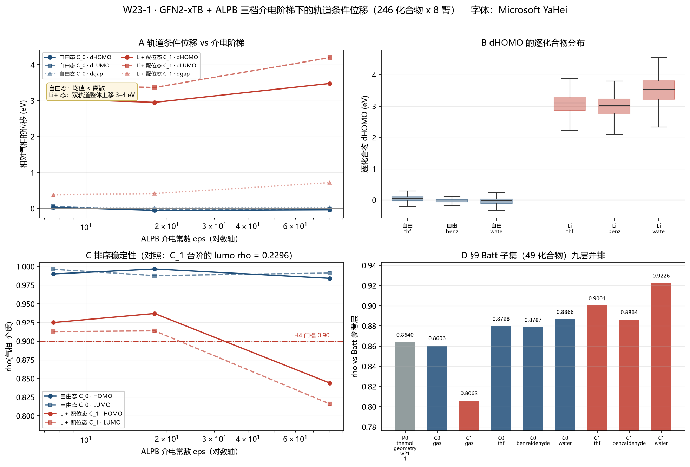

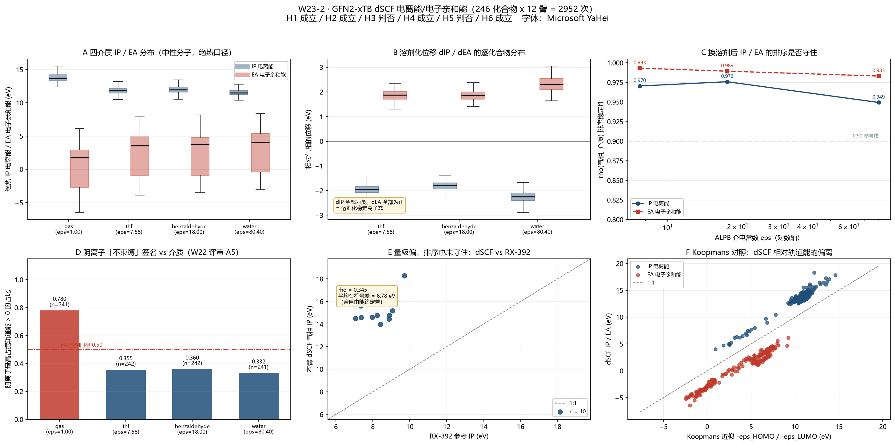

### 3.14 DFT 层级的 `P_1`/`P_2` 与 xTB→DFT 尺度桥

§3.12 与 §3.13 的台阶全部在 GFN2-xTB 层级实例化，属半经验方法；框架要求 `P_1`/`P_2` 最终落到 DFT 层级。本节用 ORCA 6.1.1（r2SCAN-3c / def2-mTZVPP / RIJCOSX / TightSCF）在 **28 个分子 × 6 臂 = 168 个单点**上完成，成功 162、失败 6。几何统一取 G1（GFN2-xTB 优化几何），三态均为**垂直** ΔSCF 单点。这一层与 §3.12/§3.13 的**绝热量**只可比符号、结构与 `tau_b`，**绝不可比绝对值**。

关键读数：`P_1` 台阶把绝对值误差从 Koopmans 的 1.364 eV 降到 **0.248 eV**；xTB→DFT 存在系统偏移 **−4.8161 ± 0.5796 eV**，但**排序相关 ρ = 0.8687、τ_b = 0.7493**（27 个交集分子）。因此更贵的电子结构方法带来了实打实的绝对值收益，但排序改善有限——**值误差的改善不自动等于决策可靠性的改善**。


### 3.15 把「数据不足」本身变成读数：抽样误差律与 σ 距离

**抽样误差律。** 对有限总体上的秩统计量，重抽标准差服从单参数闭式 `sd(N) = s0 · sqrt(1/N − 1/N_pop)`；6 条实测重抽曲线的拟合 rmse 全部 ≤ 0.0086。由此得到母体论文样本量档（N = 12）的**噪声地板 0.122**（六条曲线中位；均值 0.1212，区间 0.0862–0.1519）。工程含义：**在任何一次比较之前，就可以算出这个样本量能分辨多大的 τ_b 差异。**

**σ 距离与轴锁定。** 把本仓九条实测曲线与该论文的可比档换成 σ 距离：**氧化轴三档相对 246 普查的 |σ| 全部 ≤ 0.04**（逐位重合），**还原轴三档全部 ≥ 2.3σ**（2.32σ / 4.21σ / 6.80σ）且方向一致。也就是说，分歧不是弥散的，而是**锁定在还原轴上**。

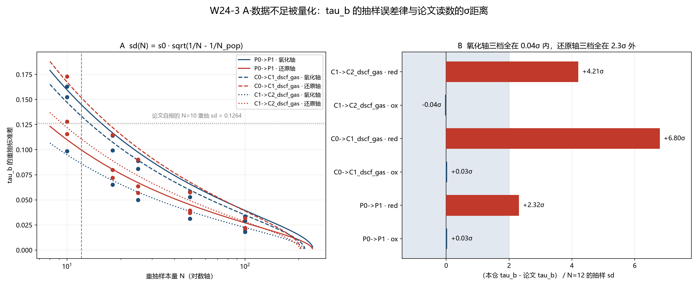

### 3.16 排序统计量与筛查可用性的脱钩

τ_b 只是一条排序统计量，它并不直接等于「筛选能不能用」。在 28 个台阶-轴上：τ_b 与 Top-10 重叠率的秩相关只有 **+0.793**，而**未解析占比与 Top-10 重叠率的秩相关是 −0.862**；到 Top-30 两者才趋同（+0.953 对 −0.910）。有 **4 个**台阶-轴满足 `τ_b ≥ 0.50` 却 `Top-10 重叠 < 0.20`，全部落在 `C_0→C_1` 还原轴上。因此：**当未解析占比超过约 0.75 时，τ_b 即便还有 0.57–0.71，头部十名已经不可用。** 报排序质量必须同时报未解析占比与 Top-k。

**一条机制读数（R5）。** 以 ΔSCF 总能量对 Born 型单参数线性做回代，达标率（R² ≥ 0.90）按起始电荷态分层：中性 **0.087**、阳离子 0.954、阴离子 0.967；`spearman(|C|, R²) = +0.523`。失效区由响应幅度 `|C|` 决定：中性态的 `|C|` 只有离子态的约 0.15 倍，相对残差反而是离子态的约 1.7 倍。Born 单参数不是「模型不够好」，而是**在小响应幅度区没有可辨识的信号**。


### 3.17 同化合物跨层级对照：分歧的因是电子结构层级

σ 距离把分歧定位到还原轴之后，还剩两个候选原因：化合物集合不同，还是电子结构层级不同？把**化合物固定住、只动层级**，原因被分开。同一批 **22 个化合物**（GFN2 与 ORCA 两侧都完整落盘的交集），几何同为 G1，源项同为 Koopmans：

**表6　同一批 22 个化合物在只换层级时的轴 τ_b**
| 同一批 22 个化合物 | 氧化轴 τ_b | 还原轴 τ_b |
| --- | --- | --- |
| **GFN2-xTB**（本仓普查层） | 0.697 | **+0.835** |
| **ORCA r2SCAN-3c**（论文同层） | 0.654 | **−0.602** |
| 变化量 | **−0.043** | **−1.437** |

论文在还原轴上的读数是 **−0.467**；我们在同一层级上量到 **−0.602**，落点贴近。两个结论因此被钉死：

1. **氧化轴未检出差异（不是「无差异」）**：换层级只动 0.043；配对 bootstrap（重抽单位 = 化合物，B = 4000，种子跑前锁定）给出 Δτ 的 95% 区间 **[−0.1982, +0.0909]、跨 0** ⇒ 在 n = 22 上**不可分辨**。
2. **还原轴对层级敏感且会翻号**：τ_b 由 +0.835 跨过零点落到 −0.602。

**因此解释要改写**：论文还原轴的「失序」既不是化合物集合差异，也不是小样本抖动，而是 **r2SCAN-3c 层级的真实行为**；**本仓 246 普查在还原轴上给出的 +0.826 才是层级伪影**。配套机制读数（同一批 22 个化合物）：还原轴位移极差由 GFN2 的 **2.55 eV** 涨到 ORCA 的 **11.97 eV**（4.7 倍），气相阴离子不束缚占比由 0.764 升到 **1.000**——一个「电子加不上去」的态，其能量排序本来就不该被当作稳定的描述符。

限制照实登记：n = 22（不是 27），两侧的 target 定义分别是 GFN2 ΔSCF 与 r2SCAN-3c 垂直 ΔSCF（几何与源项受控）；本件是后验，不得引用为预注册结论。**分辨率补充（W34-B）**：还原轴 Δτ = −1.437 的区间 [−1.704, −1.082] 不跨 0（4000 次重抽无符号翻转），但该轴的两层读数在门禁下**均判不可判定**（配对集 GFN2 气相合法 1/22、ORCA 气相合法 0/22）——可分辨的是**效应**，未过门禁的是**定义域**。

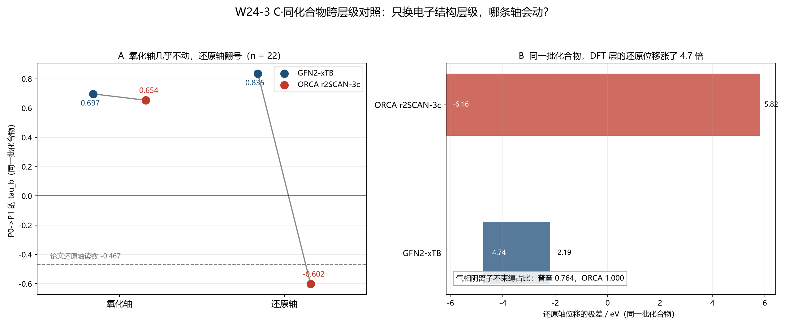

### 3.18 态合法性门禁：那条翻号的 τ_b 是在什么态上算出来的

跨层级对照留下一个从未被声明的东西：**那条翻号的 τ_b，是在什么态上算出来的？** 阴离子态如果根本不束缚，它的能量排序就不该被当作描述符宣读——但此前这点只以「不束缚占比 0.764 → 1.000」的形式停在诊断里。W33-A 把它从被动备注提为**前置门禁**：对每个（分子，介质）态要求 `geom`（阴离子态 SCF／几何完好）**且** `homo`（阴离子 HOMO < 0）**且** `ea`（绝热电子亲和 > 0），三条款之交为「合法集」，其余进**拒答队列**并记明理由；合法子集 < 5 的层级判**不可判定**，不给数值读数，也不得插补或赋伪值。

四介质的合法行数为气相 **52 / 246**（21.1%）、THF 154、苯甲醛 154、水 161；锚点合法 1/22 与 0/22。门禁后 τ_b 最大跌幅 0.182。**这不是描述符失效，而是描述符的定义域从未被声明。**

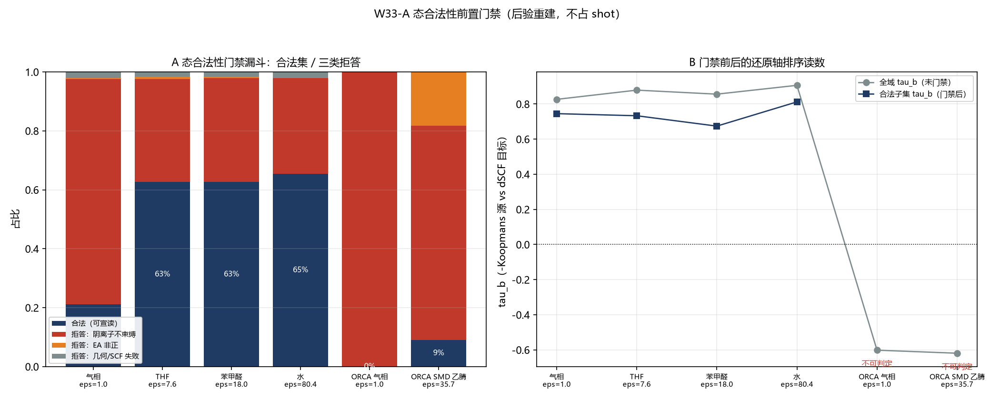

### 3.19 门禁的工程化收口：注册表、引用登记、端点容差与噪声地板

把纪律写成「跑不过就报错」的工件，是本文最可迁移的部分之一。

- **态合法性注册表。** 从报告里的一张表升为盘上注册表（1,028 行）加同体守卫：合法子集 < 5 就抛 `RedoxGateRefusal`，**不返回 None**；下游既绕不过门禁，也无法把拒答当缺失值插补。引用登记表的 10 行标记全部由守卫给出而不是手写。
- **端点判等。** 容差冻结为 1e-12；发布值与现场复算值最多差 **2 ulp**。
- **噪声地板。** 四通道噪声地板（介电 0.4737 / 粘度 0.4903 / 轨道 0.5828 / 氧化还原 0.3695）接进显示层。
- **外推校验。** 介电通道上，缺口到 s0 到 N 的外推给出 s0 0.4737 对预测 0.4214、N 129.5 对预测 118.1（相对误差 8.8%）。

**一条新读数：同一（层级，介质）在两个总体上的可宣读性可以相反。** GFN2 气相在 246 普查上合法 52 行，在 R6 的 22 个配对化合物上只有 **1/22**；ORCA 配对合法 0/2，两条均判**不可判定**、不给数值。这说明门禁不能只做一次、之后就假设它对所有子集都成立。

### 3.20 结构不等于功能与取向相关 g：两条被置换零分布检验过的机制读数

**结构-only 的 1-近邻。** 在 241 化合物上，纯结构相似度的 1-近邻只有 R² **0.2503**、ρ 0.6825、MAE 7.9869——这是**结构解释力的上界**。

**指纹相似度与标签差。** Spearman(Tanimoto, 绝对 Δε) = **−0.0607**（z = −2.1630，双侧 p = 0.0260，999 次置换），且「很像但差很大」的对数是 **0**。两个「近乎无关」的读数一起说明：**结构相似不等于功能相似**。

**取向相关因子 g。** Kirkwood-Onsager 的相对取向相关因子 `g_rel` 在给体域对非给体域的中位数比是 **2.5016**（z = 4.076，p = 0.0060；leave-top-k 2.5163 至 2.5602，n = 68 / 159），高介电族（ε ≥ 60）子群比 **15.650**。三者同向指向同一句话：**单分子描述符传不了分子间关联**——这正是「缺的那一维」。

### 3.21 三条被判为「设计缺陷」的判据改法

三条判据曾被实测判否，改法的结果是救回**问法**而不是数据：

1. **反解预算。** 原判据在 tau=15 上反解为空（alpha ≤ 0.30 内无预算能守住 0.90）⇒ 判否。改法后，tau=30 上 `alpha* = 0.06` 就能以 **10 条**推荐守住 precision ≥ 0.90；tau=15 仍照实判否。反解给出的是**存在性**，不是对未见化合物的承诺。
2. **从绝对阈值到相对判据 + 盲区判据。** 原判据「Tanimoto ≥ 0.80 且绝对 Δε ≥ 30」**0 命中** ⇒ 设计缺陷。换成相对判据（十分位比 **0.6518**，p = 0.000）加指纹盲区判据（26 对，其中 4 对绝对 Δε ≥ 5）。
3. **从拷贝的绝对门到比值判据。** 原绝对门 0.08 是从更宽阶梯抄来的 ⇒ 设计缺陷。换成比值判据后，五个干净阶梯给出 **21.04 / 13.71 / 8.09 / 4.18 / 7.27** 倍，AUC30 极差全部 < 0.02。附带的教训比读数更值钱：**W28 那张表原本把安慰剂臂与换表示臂混进同一「阶梯」，会把 AUC30 极差从 0.0056 抬到 0.5438（约 98 倍）**——比值判据的第一要求是阶梯定义干净。

### 3.22 第三个轨道与偶极外部层：QM9

把 QM9（B3LYP/6-31G(2df,p) 气相）接到名册上，命中 **103 / 241**。两层之间的**间隙**对齐给出「排序学会、量级学不会」的同一种签名：Spearman ρ **0.8856**、Kendall 0.7114、中位数比只有 **0.7058**、未标定绝对差中位数 **2.577 eV**（102/103 条 ≥ 1 eV）。留一线性标定后 MAE 从 2.533 eV 降到 **1.602 eV**（下降 36.8%），标定式复现 W39 冻结值 `xTB = 2.026697 × QM9 − 8.872895`。下降不到 50% 这条读数决定了口径：**QM9 层只能作排序先验，不能当量级标签。**

**偶极质量审计（QM9 侧）。** ρ 0.8022、MAE 0.6103 D；一致子集签署差中位数 **−0.3914 D**（约 0.39 D 系统偏置）。**排除一个候选解释**：偶极偏离的主因不是构象自由度——刚性域绝对 Δμ 中位数 **0.4442 D** 反而高于柔性域 **0.4205 D**（判否），主项更正为约 0.39 D 的系统偏置。该偏置在查清来源前**不修数、不插补**。

### 3.23 Onsager 域规则精化与双 μ 读数

把 Kirkwood-Onsager 域规则从继承的 RDKit Lipinski 给体定义，精化为**显式可给体质子**定义（机械规则，不按 ε 大小挑样本）。精化后同一批 241 化合物上的域比给出**双读数**：偏置未校正 **2.581713**、偶极偏置校正后 **3.113253**，相对变化 **0.205886**。高介电族（ε ≥ 60）方向一致：未校正 13.4044 → 校正后 **17.3170**（校正让该族更分离）。两个 μ 来源的秩一致读数 Spearman = **0.800684**，说明方向侧在两套偶极下都成立。

**条款。** 任何域间比读数必须同时给出未校正值与校正后值，并给出相对变化；`g_rel` 是无量纲相对量，只可做域间比较，不得与文献 g 绝对值对照。

### 3.24 轨道通道的外部对照层与 PubChemQC 可行性登记

**外部对照层。** Batt-P30K 按 InChIKey 复算名册命中 **73 / 241**（对齐 W38-D），作为 ωB97X-V/def2-TZVPPD/SMD(ε=18.5) 级的独立外部层。

**PubChemQC 的可行性结论按实测登记为受阻。** 侦察只读通道元数据：全局最小分片 **536,126,834 B**（约 0.5 GiB）其实**小于** 1 GiB 的可承受线，因此**阻塞不在单片体量**，而在（a）缺少按名册化合物定位分片的索引，以及（b）本机对 `pubchemqc.riken.jp` / PubChem 的 DNS 不可达。结论照实写「受阻」，并给出最小可行替代（先补索引或换可达入口），**不伪造已下载**。

### 3.25 跟踪件的稳定写入：1 / 111 → 「零待迁移」+ 22 个 owner 例外登记

W38 修好了「重跑脏树」的机制（`write_json_stable`：写入前先与盘上文件比对，除 volatile 键外完全一致则保留原字节），但当时只接线了 1 件。后续轮次把写入器逐站点迁移，并**机械扫出三类不该动的站点**，全部回退并登记为例外：

- **(a) 字节被冻结摘要 / 锁前预注册钉死**（16 个 owner）：迁移即让已交付的 summary 与盘上脚本不再一致。
- **(b) 写入站点是追加写**（4 个 owner）：`open(..., "a")` 记一行 JSONL，而稳定写入是整篇改写，会抹掉历史行。
- **(c) 原写入器带 `allow_nan=False`**（3 个 owner）：严格 JSON 语义，稳定写入会把 `NaN` 写进交付件。

三类共 **22 个 owner**（1 个同时属 (a) 与 (b)），逐条带非空理由登记进 `EXEMPT_WRITERS`。复算清单分母 **121** 件 = 已迁移 **95** + 有理由不迁移 **19**（22 个 owner）+ 待迁移 **0** + 无写入器的历史产物 **7**。**W38 登记的那 110 件没有一件仍是「待迁移」。** 三条口径必须写明：稳定写入的语义是「同一内容不重记时间」，不是「永不写」；标准两键之外还有 33 件带 `wall_seconds` 等易变字段；**例外登记不是豁免、更不是「已修」**——这 22 个 owner 重跑仍会弄脏工作树，是明确保留的已知代价。

### 3.26 W41 治理收口：准入规则、双读数条款、例外准入与轨道层级声明

W41 把 W40 登记的四条欠账逐条落成机器可复算件。四条 lane 都只读既有产物，**0 shot（累计仍 19）**，四条冻结读数（`0.4091179943351143` / `0.4766400383507876` / `0.5861142332208197` / `0.6216672295270079`）一个不动。合计 **40 条判据 = 38 成立 + 2 已登记判否**（H41b5、H41d8）。

**W41-A 阶梯池准入（9/9 成立）。** 把「阶梯 = 同一配置网格」写死为机械规则（匹配 `admit_prefix`、剔除安慰剂与换表示、重复集完整），把 40 个臂切成 **33 准入 + 7 剔除**。准入后五个阶梯的比值逐位复现 W40-A 冻结锚，AUC30 极差上限 0.018851 < 0.02。关键反事实：**W28 全 13 臂的比值只有 1.2934**，落在稳健门 4.0 之下——不写死准入规则，同一份表就会给出**假判否**。准入规则因此是判据的一部分，不是清洁工作。

**W41-B 域比双读数（9/10；H41b5 判否）。** §3.23 的双读数条款被写成硬约束：相对变化 0.205886 > 稳健门 0.10 ⇒ **只能声明「方向稳健」，不得声明「量级稳健」**；H41b5 就是这条否定声明本身。

**W41-C 例外准入（10/10 成立）。** 用**源码证据**（而非手写分组）机械复核 22 个 owner：pinned 16 / append 4（更正 W40 的 3）/ strict 3，三类重叠 1，真实重叠 owner 是 `probes/pubchem_identity_layer.py`（不是 W40 点名的另一个）；反向漏网 0（没有任何被登记 owner 含 `write_json_stable`）。

**W41-D 轨道层级声明（10/11；H41d8 判否）。** 固定名册覆盖：xTB **237/241**、QM9 **103/241**、Batt **73/241**、三方交集 **48**（4 行 xTB gap 缺失，不插补）。检查排序迁移的**可传递性**：

**表7　W41-D 轨道层级声明：排序迁移的可传递性**
| 对 | 全域 n / ρ | 三方交集 n / ρ |
| --- | --- | --- |
| xTB–QM9 | 103 / 0.885628 | 48 / 0.859741 |
| QM9–Batt | 48 / 0.817674 | 48 / 0.817674 |
| xTB–Batt | 73 / 0.330371 | 48 / 0.538428 |

同一批 48 化合物上，ρ(xTB, QM9) = 0.8597、ρ(QM9, Batt) = 0.8177，但 ρ(xTB, Batt) = 0.5384：**排序一致性不可传递**。非传递间隙 `min(0.8597, 0.8177) − 0.5384 = 0.2792 > 0.2`，H41d8「跨层排序先验可当作另一层的代理」**判否并登记**。进一步，三层两两都是跨层级，**同层级外部源数 = 0**——W40 登记的第 3 条仍未满足。

**这四条 lane 合起来给出一条方法论**：在层级混杂、来源异构的筛选里，判据本身的**准入规则**与**声明边界**也要被预注册、被机械复算、被登记为负结果。

---

### 3.27 W42 计算密集型收口：第三外部轨道层、四层迁移网络与三源偶极归因

W42 是**计算密集型周**：把新接入的 PubChemQC（B3LYP/6-31G*//PM6 气相，CC BY 4.0）作为第三个外部轨道源，在固定 241 行名册上一次性完成四层覆盖面、两两迁移（含 bootstrap 与置换）、非传递闭合、isotonic 代理上界、三源偶极分解与抽样律／域比重抽。四条 lane 全为只读离线计算，**0 shot（累计仍 19）**，四个冻结读数（`0.4091179943351143` / `0.4766400383507876` / `0.5861142332208197` / `0.6216672295270079`）一个不动；合计 **45 条判据全部成立**（本轮无新增判否）。

**四层轨道迁移网络（W42-A，13/13 成立）。** 覆盖：xTB **237** / QM9 **103** / PubChemQC **205** / Batt **73**，四路交集 **48**；全部 15 个交集逐条复算自洽。6 个两两序列（full 交集）的 Spearman ρ：

**表8　四层轨道迁移网络的 Spearman ρ**
| 对 | n | ρ | 95% CI | 置换 p |
| --- | ---: | ---: | --- | ---: |
| xTB–QM9 | 103 | 0.8855 | [0.8158, 0.9252] | 0.0005 |
| xTB–PubChemQC | 205 | 0.8824 | [0.8346, 0.9139] | 0.0005 |
| xTB–Batt | 73 | 0.3280 | [0.1108, 0.5146] | 0.0015 |
| QM9–PubChemQC | 103 | 0.9823 | [0.9586, 0.9927] | 0.0005 |
| QM9–Batt | 48 | 0.8177 | [0.6846, 0.8991] | 0.0005 |
| PubChemQC–Batt | 71 | 0.7386 | [0.5994, 0.8365] | 0.0005 |

6 对的 bootstrap 95% CI 下界全部 > 0、置换 p 全部 ≤ 0.006。**关键结构**：QM9 与 PubChemQC 同泛函（B3LYP）、同相（气相），彼此 ρ = **0.9823**、gap MAE 仅 **0.1612 eV** ⇒ 判 **near_same_level**。这更新了 §3.26 的「同层级外部源数 = 0」：现在有一个 near-same-level 源，但 **strict same_level 仍为 0**（基组 6-31G(2df,p) vs 6-31G* 与几何 B3LYP vs PM6 仍不同）。四个三角形里，凡跨到 xTB 的断口最大 **0.4897**（断链边恒为 xTB–Batt），而 QM9–PubChemQC–Batt 的 gap 只有 **0.0790**：**四层里的断链在 xTB–Batt 这条边上**，与 §3.26 的不可传递判否同向。

**isotonic 代理上界（W42-B，10/10 成立）。** 在 73 个同时有 xTB 与 Batt gap 的化合物上，保序（isotonic）回归把 Spearman 从 **0.3280** 抬到样本内 **0.5461**、样本外（5 折 CV）**0.4150**；平方误差侧样本内 R² **0.3310**、CV R² **0.2225**。阈值任务上，中位数二分 AUC 由 raw **0.6922** 抬到 CV **0.7305**，上四分位二分 CV AUC **0.7719**。与 xTB→QM9（ρ = 0.8855）相比，**代理保真度比只有 0.3704** ⇒ xTB 可以代理 B3LYP 气相通道，**不可代理 ωB97X-V/SMD 通道**。§3.26 登记的 item 34 由此从「弱」升级为「有样本外上界的弱」。

**三源偶极归因（W42-C，11/11 成立）。** our（xTB）/ QM9 / PubChemQC 三源两两：QM9 − PubChemQC 的 bias 只有 **−0.0341 D**（MAE 0.2078，bootstrap CI 含 0），而 our − QM9 = **+0.3945 D**、our − PubChemQC = **+0.5130 D**（两 CI 均不含 0）。三源 OLS `our = 0.2361·QM9 + 0.6354·PubChemQC + 0.6089`，R² **0.6515**；偏置定位比 min/max = **0.7691**（同号）。**~0.4 D 系统偏置因此定位在方法层（xTB vs B3LYP），不是某一个外部源的数据问题**；本轮仍**只归因、不修数、不插补**，§11 第 28/30 条的修数禁令继续有效。

**抽样律与域比重抽（W42-D，11/11 成立）。** `sd(N)=s0·sqrt(1/N−1/N_pop)` 在 6 条四层轨道序列上重拟合：最大 rmse **0.0084**（< 0.012），s0 区间 **[0.2501, 0.6475]**，且 **Spearman(s0, 1−τ) = 0.9429** —— 与 §3.15 的 W32-A 一致，s0 是排序保真度的函数，不是通道常数；xTB–QM9 在 N=12 的噪声地板 **0.1138**。域比 **2.5817133417** 逐位复现，bootstrap 95% CI **[2.1220, 3.2271]**（sd 0.3033），置换 p = **0.0005**（0/2000 超观测）；偏置校正读数 3.1133 落在未校正 CI 内，与 H41b5「方向稳健、量级不稳」自洽。

一句话：**W42 把「第三外部层」从一个待办变成一张可复算的四层网络**——它同时给出了 near-same-level 声明、xTB–Batt 代理的样本外上界、偶极偏置的方法层定位，以及四层抽样律的 s0 保真度依赖。

### 3.28 W43 收口：层级残差的适用域条款、偶极校正协议预注册、层准入规则与治理台账守卫

W43 把 W42 在收口时登记的两条欠账（README §11 第 36 / 37 条）落成机器件，并补两条新登记。四条 lane 全为**只读离线计算与治理件**，**0 shot（累计仍 19）**，四个冻结读数（`0.4091179943351143` / `0.4766400383507876` / `0.5861142332208197` / `0.6216672295270079`）一个不动；合计 **45 条判据全部成立**（本轮无新增判否）。

**层级残差分解与适用域条款（W43-A，15/15 成立）。** 名册上 xTB–Batt 只有 **73** 行、ρ = **0.3280**，不足以判断层级真值。本轮接入大样本同层级扩展层 `themol_orbital_layer_expanded.csv`（**5117 行**，GFN2-xTB//B3LYP-D3(BJ)/DZVP 气相单点，**DFT 几何**），把该对扩到 **4668 行**：ρ = **0.5985**（Kendall 0.4243、Pearson 0.4343），比名册子集高 **0.2705** ⇒ **名册 73 行是悲观尾，不是层级真值**。残差拆成两档：

- **同方法换几何**（THEMol 几何 vs DFT 几何，GFN2-xTB 气相，n = **137**）：ρ = **0.9916**、Kendall 0.9397、Pearson 0.9974，但 MAE = **0.1599 eV**、有符号均值 +0.0381 eV ⇒ 换几何**保序极好、电平整体平移**（level-shift，不是 rank-break）。
- **同泛函换基组**（QC 6-31G(2df,p) vs 6-31G*，n = **103**）：平均 |Δ| = **0.1612 eV**、最大 |Δ| = **0.8599 eV**；|Δ| ≤ 0.2 eV 覆盖 **0.6893**、≤ 0.3 eV 覆盖 **0.8350**、≤ 0.5 eV 覆盖 **0.9612** ⇒ `near_same_level` 只能当**带 ±0.2 eV 容差的替换上界**，不是严格同层级。

isotonic 代理在 4668 行上的样本外上界：ρ raw **0.5985** → 样本内 **0.6172**、5 折 CV **0.5995**；CV R² **0.4041**；中位数二分 AUC raw **0.7969** → CV **0.7957**（上四分位 CV 0.7835）。描述符面板（扩展层 ∩ 名册 ∩ 双端 gap 齐备，n = 45）里，主 residue 与 `homo_lumo_gap_ev` 的 |Spearman| 最强（**0.6414**），其余描述符都在 0.12–0.19 档。上述三条写死进 `probes/artifacts/w43_applicability_clause.json` 的适用域条款：同方法与基组残留分别判 `rank_preserving` 与 `usable_as_bound`，跨方法恒判 `not_same_level`，**`strict same_level` 计数为 0**。

**偶极校正协议预注册（W43-B，12/12 成立）。** 把 ~0.39 D 的 xTB→B3LYP 偏置写成协议 `dipole_transfer_v1`，状态 **`registered_not_authorized`**（**本轮不执行校正**）。协议含三个变体（legacy 带符号常量、shift 均值/中位偏移、affine OLS `mu_corr = 0.1623 + 0.7506·μ`）、适用范围（须有任一 B3LYP 气相偶极层）、回退（缺外部偶极即原样返回并标 `correction_applied=false`）与失效闸（LOO 偏置 CI 跨 0 或 MAE 未降即判不通过）。估计诊断（名册 ∩ QM9，n = **103**）：仿射 R² **0.6142**，未校正 MAE **0.6103 D** → 校正后 **0.4605 D**，LOO 偏置 **0.3945 D**、95% CI **[0.2248, 0.5788]** 不含 0（偏置真实、协议过失效闸）。离线影响评估（W40-C 域表 241 行）：未校正域比 **2.5817134** → legacy **3.1132529**（逐位复现 W40-C，max|Δ| ≈ 1.8e-15）、shift 均值 **3.1122200**、shift 中位 **3.1726331**、仿射 **2.4695764**，**四个变体的 |Δ| 全部 ≤ 1.0**（同档扰动，不是结论翻转）；因 `mu_corr ≤ 0` 被丢弃的行 0 / 26 / 29 / 0。**任何校正后偶极都不得替换标签或作特征列**。

**层准入规则（W43-C，10/10 成立）。** 把「外部轨道层能不能当 Batt 通道的只读排序先验」写成机械评分 `score = 0.5·ρ(·,Batt) + 0.2·coverage_frac + 0.2·unit_check_frac + 0.1·structure_check_frac`，配硬门：`admit` 需 score ≥ 0.6 且 ρ ≥ 0.5 且 unit_check_frac ≥ 0.9 且 license 合规。四层判决：xTB **defer**（score 0.6607 但 ρ = 0.3280 未达 0.5 门）、QM9 **defer**（元数据缺项：unit/structure 核验字段未随层发布）、PubChemQC **admit**（score **0.8394**、ρ 0.7386、unit/structure 均 1.0、CC BY 4.0）、Batt **reject**（标签目标层，硬规则永不作先验）。`near_same_level(qm9,pubchemqc)` **未被自动准入**（QM9 缺元数据），`strict same_level` 计数仍为 **0**。

**治理台账守卫（W43-D，8/8 成立）。** 把全仓 `probes/**/*.json`（**337** 个可解析 JSON）当一本台账机器校验四条不变式：登记负结果并集 == 已知 **9** 条（`H38a2`/`H38b1`/`H39a7`/`H40a5`/`H40c10`/`H40c11`/`H40d8`/`H41b5`/`H41d8`，**W43 无新增**）、冻结读数越界计数 **0**、带 ledger 的 summary **41** 份的累计 shot 序列**单调不减且上限 19**、本轮 W43 各件 `shots_this_week` 全为 0。逐文件台账落 `probes/artifacts/w43_governance_ledger.csv`。

一句话：**W43 把「层级能不能互换」「偶极能不能校正」「哪一层能当先验」「台账有没有漂移」四件事从口头约定变成四张可复算的机器表**，并且在校正与修数上继续保持零授权。

### 3.29 W44 收口：层准入闸门、逐轮验收运行器、strict same-level 机器要求与 AST 静态守卫

W44 把 W43 收口时登记的两条治理欠账（README §11 第 38 / 39 条）接进机器：把层准入表升成会抛异常的闸门、把治理台账守卫做成逐轮验收运行器，并补一条 strict same_level 的机器要求与一条 AST 静态守卫。四条 lane 全为**只读治理件与静态审计**，**0 shot（累计仍 19）**，四个冻结读数（`0.4091179943351143` / `0.4766400383507876` / `0.5861142332208197` / `0.6216672295270079`）一个不动；合计 **31 条判据全部成立**（本轮无新增判否）。

**层准入闸门 + 全仓消费者审计（W44-A，8/8 成立）。** 把 W43-C 的层准入表升成闸门 `admit_prior(layer, use)`：只有 `verdict == admit` 的层可作排序先验，否则抛 `PriorRefused`（未登记的层同样拒绝）。机械审计扫 `probes/` 与 `reports/` 共 **611** 个 `*.py` / `*.md`，命中 **18** 个（文件 × 层）对，全部为声明/规则/交付记录，**运营性先验使用 1**（正对照 pubchemqc，已过闸）、**未申报先验使用 0**。负对照 `ccsd_t`（从未登记的新层）/ `qm9`（defer）/ `batt`（标签目标层）**全部被拒**，正对照 PubChemQC **过闸**。

**逐轮验收运行器（W44-B，7/7 成立）。** 复用 W43-D 的四个台账不变式，扫 `成果输出/week*/week*_summary.json` 共 **41** 轮：其中 **33** 轮声明了验收字段，判 **fail 0** 轮（早期轮次缺字段记为 `not_declared`，运行器**不替它们补字段、也不算 fail**）；最近五轮 week40–week44 **全部通过**，台账不变式全成立。

**strict same_level 机器要求 + 在仓候选审计（W44-C，8/8 成立）。** 把「同层级」写成**四属性全同**（functional / basis_set / phase / geometry_source）+ 独立来源，target 是 Batt（ωB97X-V / def2-TZVPPD / SMD）。六个在仓候选层（xTB、QM9、PubChemQC、Batt、ORCA r2SCAN-3c、扩展层）逐一填属性表并按名册算覆盖：与 Batt 属性距离为 0 的层 **0** 个（`strict same_level` 计数 **0**，本轮**登记为已知边界**而非判否）；所有候选两两算属性距离，**最近一对 = QM9–PubChemQC，属性距离 2**（仅泛函 B3LYP 与相气相相同，基组与几何各异），与 xTB–扩展层并列最近；`near_same_level` 合法对恰为这两对，**越权 near 声明 0**。

**AST 静态 shot / 冻结读数守卫（W44-D，8/8 成立）。** 用 `ast` 解析 `probes/` / `scripts/` / `src/` 下 **359** 个 `*.py`（**1,302,367** 个 AST 节点，解析错误 **0**）。冻结注册表 `METRIC_NAMES` / `EXPECTED_METRIC_NAMES` 的两处定义都等于冻结 **7** 项（**mutation 0**），另有 **3** 个老探针的私有同名 4 项局部量登记为 `legacy_local`、不计 mutation；四个冻结读数出现在**赋值左侧 0 次**、作右侧引用 **267** 次；`promoted = True` 未登记 **0** 处。

一句话：**W44 把「先验要先过闸」「每轮都要验收」「同层级有机器定义」「主记分牌不许被静态改写」四件事从登记条目变成会失败的机器件**，而 shot 与四个冻结读数继续零变化。

### 3.30 W45 收口：标定列的泄漏审计、扩展层分层残差与偶极偏置的分层归因

W45 转入计算：审计 W43 落下的标定列、把 4668 行 xTB–Batt 分层、把 ~0.39 D 偶极偏置分层归因，并把三条治理守卫复跑成快照。四条 lane 全为**只读计算**，**0 shot（累计仍 19）**，四个冻结读数（`0.4091179943351143` / `0.4766400383507876` / `0.5861142332208197` / `0.6216672295270079`）一个不动；合计 **37 条判据全部成立**（本轮无新增判否）。

**标定列的保真与泄漏审计（W45-A，10/10 成立）。** 扩展层的 `calib_homo_eV` 是 `homo_gfn2_eV` 的**精确一元仿射** `calib = 0.8702565775077505 · homo_gfn2 - 0.20421040258262516`（4668 行最大残差 **1.8e-15**），且与 `homo_gfn2 -> homo_batt` 的 in-sample OLS **逐位同映射**（slope/intercept 差 ≤ 4.4e-16）；449 行 `calibrated_estimate` 套用**同一条**映射（残差 1.8e-15）。仿射保序 ⇒ ρ(calib_homo, batt_homo) 与 ρ(homo_gfn2, batt_homo) **完全相同**（差 **0.0**）：**标定只补电平（MAE 1.2066 → 0.3032 eV）不补序**。5 折（按 InChIKey 哈希分折）out-of-sample 复拟合 MAE **0.30329 eV**、泄漏缺口 **1.3e-4 eV**。`calib_lumo_eV` 列在 4668 行上**全为空**（标定只覆盖 homo，登记为已知边界）。

**扩展层分层残差（W45-B，10/10 成立）。** 总体 ρ(gap_gfn2, gap_batt) 逐位复现 **0.5984785837315431**（bootstrap 95% CI **[0.5800, 0.6173]**、置换 p **0.0005**）。tier 分层同质：calibration_bulk **0.5974** / flagship_dielectric **0.5280** / named_core_channel **0.5130**（与 bulk 最大间距 0.084 < 0.15）。重原子数分层则**单调退化**：5–12 **0.8107** / 13–17 **0.7315** / 18–40 **0.4810** ⇒ xTB 的排序信息集中在**小分子**上。Δgap 含 **6.9873 eV** 的系统电平差（MAD **0.6400 eV**），故离群只能用**去中位后的稳健尺度**判：|z|>3.5 比例 **0.1165**。

**偶极偏置的分层归因（W45-C，10/10 成立）。** 重合 n = **103**，均值偏置 **+0.39451165048543685 D** 逐位复现 W42-C（bootstrap 95% CI **[0.2296, 0.5639]**、符号翻转置换 p 0.0005、Wilcoxon p 9.4e-11）。分层：HBD 0 / 1 / 2+ 中位 **0.3793 / 0.4205 / 0.9831 D**；重原子数 1–5 / 6–7 / 8–9 中位 **0.3364 / 0.4424 / 0.4088 D**；**偶极三分位 low 0.0598 / mid 0.4817 / high 0.5207 D** ⇒ **偏置不是常量平移，而随偶极幅度增长**（偏置幅度 vs 偶极幅度秩相关 **0.4775**；vs 重原子数仅 **0.0234**，不是尺寸伪影）。这条直接支撑 W43-B 协议里 **affine 优先于 shift**。

**治理复跑快照（W45-D，7/7 成立）。** 三条守卫在本轮复跑全绿：闸门 3 个负对照全拒、PubChemQC 过闸、未申报 0；逐轮验收 **42** 轮、fail **0**、最近五轮全过；AST 静态守卫 **365** 文件、mutation **0**、冻结读数写入 **0**；台账登记负结果并集 **9** 条、冻结读数越界 **0**、累计 shot 上限 **19**。闸门判决表与 W43 准入表逐项一致。

一句话：**W45 把「扩展层里那列标定到底是什么」与「两个已知偏置在哪类分子上最重」都算清了——标定是 in-sample 仿射、只补电平不补序；偶极偏置随偶极幅度增长、是尺度问题而不是平移问题**。

### 3.31 W46 收口：还原轴描述符重定义与功效边界

W46 承接 W45 留下的那句话——「还原轴需要重新定义」——把它拆成三个可复核的问题：**候选描述符族怎么定义（A）、同装置锚点到底有多少（B）、现样本量下能分辨多大的 τ（C）**，再把结果回填成一节。四条 lane 全为**只读计算、侦察与治理件**，**0 shot（累计仍 19）**，四个冻结读数（`0.4091179943351143` / `0.4766400383507876` / `0.5861142332208197` / `0.6216672295270079`）一个不动；合计 **36 条判据全部成立**（本轮无新增判否）。

**锚点侦察（W46-B，10/10 成立）。** 扫 `data/`、`reports/`、`probes/`、`docs/` 共 **518** 个 CSV，按预注册的候选列词元族（`reduc*` / `red` / `ea` / 「还原」）命中 **151** 条候选列与 **32** 件命名对照，逐件裁定：计算系列（Batt / QM9 / PubChemQC / xTB 层）一律 **rejected_computed_only**；盘上的实验件（`anchor_crosscheck` 等）量的是**介电常数**，判 **rejected_criterion_mismatch**；唯一已知的还原旁证（FEC 1.2 V / VC 0.74 V / EC 0.7 V，DOE APR FY2016，secondary，n_pairs = 3）**未作为结构化表落盘**，登记为 **not_available_on_disk**。层准入闸门 `admit_prior` 复核六个考察层：仅 PubChemQC 过闸，其余全部被拒（未登记 = 不准入）。**结论：可用同装置还原锚点数 n_anchors = 0 < N_min = 5，n_pairs_effective = 0。**

**候选描述符族（W46-A，8/8 成立）。** 预注册锁死四候选 D0 裸 LUMO / D1 门禁过滤绝热 EA / D2 Li⁺ 耦合还原位移 / D3 溶剂化垂直 EA，放进（候选 × 层）网格。r2SCAN-3c 层上 D0 可用 28 分子，但 D1 的「阴离子束缚」合法子集为 **0**、D3 的溶剂化合法子集为 **2 < 5**，均判**不可判定**，不给数值、不插补；D2 在 r2SCAN-3c 层根本没有原料（需新 ORCA 单点）。GFN2 层上 D0/D1/D2 三者可用。于是主判据（D1/D2/D3 相对 D0 的 Δτ_b 的 bootstrap CI）**按 H46a2 不执行**，本件产出自动降级为**不可判定 + 功效下限**，与 W33 ORCA 层先例同规格登记，**不算失败**。

**方向性读数（不判）。** 在 GFN2 合法气相子集（n = 48）上，D0–D1（Koopmans 代理对绝热 EA）τ_b = **0.7394**、未解析占比 **0.3980**；D0–D2 τ_b = **−0.3794**、未解析 **0.8697**；D1–D2 τ_b = **−0.4486**、未解析 **0.8874**。读法：**Li⁺ 一配位（D2）之后，还原描述符与裸分子 EA 的排序几乎脱钩，且未解析占比逼近 0.9**——这与 §3.16 的五官读数同向，但**只作机制读法，不进判决**。

**功效边界（W46-C，10/10 成立）。** 把「τ_b 的噪声地板」工具化为 `tools/taub_power.py`（只读，不接主记分牌），并接到盘上产物：Gate 1 的 n = 7 下，**可检测最小 τ（80% 功效）MDE = 0.6541**；τ_true = 0.4 / 0.6 / 0.8 时功效分别只有 **0.2300 / 0.6299 / 1.0000**，而越过 0.9 阈的概率只有 **0.0044 / 0.0114 / 0.0809**；达到 80% 功效所需锚点数为 **17 / 8 / 6**。离散精确口径在 n = 7 的 α_eff = **0.034523809523809526**（名义 0.05 的保守侧）；连续化口径的蒙特卡洛拒绝率 **0.05015**（200000 次重抽）与名义 α 一致；与 W33 精确零分布在 n = 7 上**逐点一致（最大绝对差 0.0）**。**Gate 1 观测值 τ_b = 0.4285714285714286 的精确单侧 p = 0.11944444444444445（602/5040）**——它既不能判「机制脱节」（p 未过 0.05），也不能判「功效不足到无信息」（p 也不算大）。

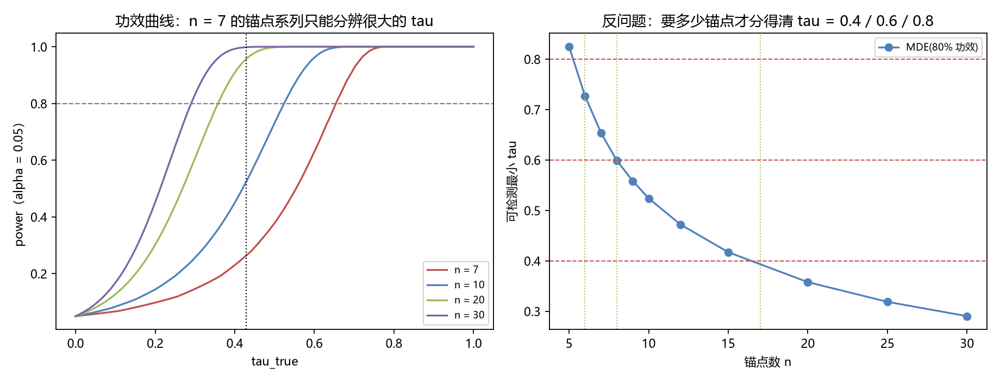

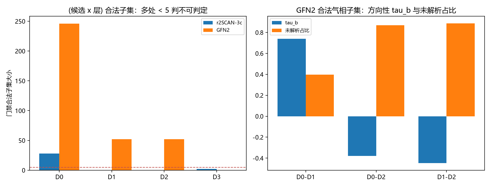

**Gate 1 措辞三处修订（据此冻结）。** ① **阈 0.9 的操作特性写进局限**：n = 7 下阈 0.9 等价于「至多 1 对不一致」，即便 τ_true = 0.8 也仅有 8.1% 概率过阈——**阈 0.9 在这个样本量上不是一个有检出力度的门**。② **P0 0.5238 与 P1 0.4286 不声称优劣**：两者在本样本量下的区间大幅重叠，我们**不主张**某一层或某一描述符「更好」；差异落在功效地板之内。③ **p = 0.1194 的两竞争解释并列**：观测值未过 0.05，**「机制脱节」与「功效不足」两个解释在本样本量下不可分**，必须并列陈述，不得只报其一。

一句话：**W46 把「还原轴需要重新定义」推进成一个可执行的结论——候选族的定义、锚点的缺口（0 个同装置锚点）、以及现样本量的功效边界（n = 7 的 MDE 0.6541、要分辨 τ = 0.6 需 ≥ 8 个锚点）三者都被算清并落盘**，而 shot 与四个冻结读数继续零变化。

### 3.32 W47 收口：双轨还原锚点、主判据执行与投稿就绪评估

W47 承接 W46 登记的三处缺口（D2 的 r2SCAN-3c 版本、D3 的 ddCOSMO 垂直 EA、同装置还原锚点 ≥ 5）。取件核实推翻了 W47 计划对 Borodin 2013 的归属假设，也把这一轮从「新增算力」改成「把源读对、把覆盖算清、把拒答写实」。四条 lane 全为**只读转录与治理件**，**0 shot（累计仍 19）**，四个冻结读数（`0.4091179943351143` / `0.4766400383507876` / `0.5861142332208197` / `0.6216672295270079`）一个不动；四条 lane 合计 **38 条判据全部成立**（本轮无新增判否）。

**三张转录锚点表（W47-A，9/9 成立）。** 把 Borodin 等（2013）Table 1 计算氧化（**16 行**，G4MP2/PCM，ε=1 与 ε=20 四列）、Table 3 实验氧化（**26 行**，含脚注与 ref 解析）、Borodin 等（2015）图 6/7/8 的 Li⁺ 耦合还原（**8 行**）装成只读锚点，行数与 sha256 三处钉住。**关键更正**：计划里「Borodin 2013 有 68 个 EA + 86 个 IP 的 G4MP2 表」是**错误归属**——那是其 ref51（Vydrov 等 2006，G2 离子测试集，实为 **58 个 EA**，且无电解液溶剂）的内容；Borodin 2013 是**纯氧化**论文，**全文无还原/EA 表**。

**覆盖核算与主判据的诚实结算（W47-A，同一件）。** 在核心集 7 个溶剂 {EC, PC, EMC, MA, SL, DOL, DMSO} 上：**计算氧化 4/7**（EC/PC/EMC/SL）、**实验氧化 4/7**（同为 EC/PC/EMC/SL 的单溶剂行）、**计算还原 1/7**（仅 EC，Borodin 2015 Li⁺ 耦合，且为计算件）、**实验还原 1/7**（仅 PC，Moshkovich 2001）。还原轨并集 **2 < 5** ⇒ **H47a2 拒答分支触发**：D0–D3 主判据**不执行**，降级为「不可判定 + 功效下限」，与 W33 ORCA 层先例同规格（**不算失败**）。**还原锚点缺口并未被填上**——这是本轮最重要的负向结论，必须照实说。

**氧化轴计算-实验交叉一致性（W47-A，敏感性读数）。** n = 4 溶剂上计算 G4MP2 绝热氧化自由能（ε=20）对实验氧化电位：**τ_b = 0.6667**（精确单侧 p = **0.1667**，bootstrap 95% CI = **[−1.0, 1.0]**——10000 次重抽中 152 次退化已剔除，n = 4 的区间几乎不携带信息，故这条只能是敏感性读数），**Top-1 重叠 1.00 / Top-2 重叠 0.50**，未解析对占比 **0.3333**；敏感性列 ε=1 的 τ_b 降到 **0.3333**。门禁过滤在本件**不适用**（W33 门禁按 InChIKey 在 gfn2/orca 层注册，转录表是外部 G4MP2 层、无 InChIKey），已显式登记而非静默跳过。**这条只作敏感性读数，不进判决、不写进摘要级结论**——n = 4、6 对，任何单独引用 τ_b 的写法都被预注册禁止。

**实验轨的降级与逐件台账（W47-B，8/8 成立）。** Moshkovich 等（2001）经取件核实为 **PC 单溶剂 × Li/Na/K 高氯酸盐**、Au 电极，**窗口值在 CV 图里而无溶剂×盐表** ⇒ 重分类为 `mechanism_evidence_only`（阳离子依赖机理证据），不是锚点行。台账共 **9 件**，每件都有 verdict 与非空的 `condition_flag`：不可得 3 件（Okoshi 2015 / Ue 1994 / DOE APR FY2016）、计算件 3 件（Borodin 2013 Table 1、2015 图 6–8、2019 换算）、轴不匹配 1 件（Borodin 2013 Table 3 全为氧化）、待取原件 1 件（**Ue 1997，JES 144, 2684**）。实验轨裁决 = **`not_evaluable_condition_differs`**（核心集覆盖 1/7 < 5），**只作 D2 的敏感性检验对象，不作 Gate 1 主检验替换**。

**D2/D3 协议冻结与算力欠账（W47-C，9/9 成立）。** D2（r2SCAN-3c）六项协议齐备，含**多构象采样 + 构象散布必报**（Borodin 2015 的 EC/Li⁺ 三个还原几何 0.48/0.53/0.61 V ⇒ 构象敏感性约 **0.13 V**，不许只报单一构象）；D3（ddCOSMO）四项齐备，**垂直用非平衡 NE、绝热用 EQ**（V4 分工），沿用 W26 介电响应管线；腈类 GN/MPN/BC 的 **SOMO 空间分布 / 偶极束缚态判据 / 门禁注册表条目**三项 × 3 溶剂 = **9 行**齐备（缺一项即该溶剂的检查判据不成立）。本环境**无 ORCA 可执行体**，故全部条目登记 `pending_orca_compute`，并给出排期估算 **76 个单点**（估算，不是读数）。完成后按**同一预注册**重跑 Lane A，两版读数并列登记。`dipole_transfer_v1` 维持 `registered_not_authorized`。

**投稿就绪评估（W47-D，12/12 成立）。** 第二批引用 **13 篇**全部在参考文献节内逐条命中（转录源 3 篇 + 方法护栏 3 篇 + 换算/换算链 2 篇 + 定位段 2 篇 + 进展 3 篇），§1.2 定位段补 **Abaei 2026**（MOF 领域「ranking 与 regression 分离」的跨领域同修辞）与 **Deng 2026**；§4.6 把未闭合项照实写清（还原锚点仍 0、D2/D3 转 round-2、Ue 1997 待取原件）。10 条就绪闸门**全部通过**（引用完整 / §3.32 在位 / 定位段更新 / 局限更新 / **无附录** / 论文引用的 25 张图全部在盘 / 四个冻结读数无变体 / 9 条负结果不变 / shot 上限 19 / 未闭合声明齐备）。**剩余阻塞项是科学证据而非稿件形式**：同装置实验还原锚点 0、D2 与 D3 未算、Ue 1997 还原侧未核实；本件只出「条件可投、边界已声明」的评估，**投稿决策不由本件作出**。

一句话：**W47 把「还原轴需要重新定义」推进到「已重定义，但 computed-anchor 检验因锚点覆盖 2/7 < 5 而不可判定；氧化轴交叉一致性 τ_b = 0.6667（p = 0.1667）只作敏感性读数；实验轨条件差异照报」**——三条读数（覆盖 2/7、主判据不可判定、实验轨 `not_evaluable_condition_differs`）都被算清并落盘，shot 与四个冻结读数继续零变化。

---

## 4 讨论

### 4.1 三条边界，而不是三个失败

数据集交付时通常只给「能用」的部分。本工作反过来，把三条边界量化后一起交付：

1. **缔合盲区。** 显式的氢键给体规则（D1）把域外样本分离出来，域内 R² 0.5240 对全域 0.4540；被排除的样本主要是自缔合质子性液体，它们的 ε 由取向相关因子 g ≫ 1 驱动，而 g 是**单分子描述符在原理上不带的一维**。
2. **骨架外推。** 骨架/簇留出下 R² 跌到 0.1383–0.2953，但 Spearman 仍保持 0.5970–0.7565。
3. **强极性空白。** PC 预测 21.6 对实测 64.9、EC 预测 33.7 对实测 90.5，以及共形区间在 ε > 60 分层上从名义 90% 崩塌到 1.5%–26%。

把这三条写成「边界」而不是「失败」，有一个具体的工程后果：下游使用者知道在什么条件下应当拒答或转人工。这正是高 ε 区拒答规则的来源。

### 4.2 把科研纪律写成可执行断言

本工作最可迁移的部分不是模型，而是把纪律工程化的方式。三条经验：

**第一，预注册必须冻结到「判词由哪一支臂决定」这一层。** 仅仅冻结「我要调参」是不够的：如果网格里读数最高的臂可以事后当选，预注册就退化成形式。第 20 周的旁臂 0.6249509650342622 高于注册臂 0.6216672295270079 而未被采用，就是这条纪律的实际执行。

**第二，安慰剂必须*预先*写死塌缩判据。** 「跑个安慰剂看看」是不够的；判据必须在跑之前冻结。同样重要的是：当安慰剂**未**塌缩时，必须照实登记而不是隐去——本工作 η 通道的安慰剂就未塌缩，因此被降级为不可引用。

**第三，负结果要有位置可放。** 如果交付物里只有「成功」的格子，失败就会被逐步删除，最后没人记得哪条路走过。本工作为此维护了负结果登记与已废弃数字黑名单两样东西，并把判据本身的准入规则也纳入复算。

### 4.3 「有界达标」该怎么读

第 20 周的 0.6217 需要一句明确的读法说明，否则极易被误读。

- 它是一个**跨种子均值**，不是单次运行的最好值；对应的五种子下界是 0.6000，恰好压在 0.60 门限上。
- 它属于**一块特定的记分牌**（457 行 / 97 化合物 / GroupKFold by InChIKey / 原尺度 R²），不可与数据集级基准互比，也不可与头条 0.4766 或基线 0.4091 相除、相加。
- 它**不重写**冻结头条与冻结基线：新读数是一条带适用条件的新事实。
- 它的机制是**超参欠拟合的修复**（稠密 13–15 列特征配深度 2），因此外推性受限于「表示不变、只换优化器」这一条件。

我们把它称为「有界达标」：读数过门，但过门条件被显式写下来。这是本工作愿意提交的最高强度主张。

### 4.4 口径纪律：本批文献里没有同口径对手

一个必须照实说明的事实：我们调研过的同领域文献在报告 ε 类结果时，划分方式基本是随机划分，**没有一篇报告化合物分组口径下的 ε R²**，部分工作的性质预测甚至全部来自代理模型输出、从未以化合物分组口径审计。后果是：我们不能用文献来证伪或支持 0.60 这个门限（口径不同，比较不成立）；反过来，我们的 GroupKFold-by-InChIKey + 原尺度 R² + 泄漏审计 + 安慰剂，是这批工作中**最严的一档口径**。「读数上不去 0.60」换来的是可审计性，这是一个可以正面陈述的取舍。

### 4.5 负结果与封顶总表

本工作把负结果当作一等交付物。下表汇总被实测证否或被更正的方向（完整条目与证据文件见仓库 `reports/` 与 `probes/artifacts/`）。

**表9　负结果与封顶总表**
| 编号 | 方向 | 结果 |
| --- | --- | --- |
| — | 换拟合器 | GPR 0.2313、MLP −0.172 |
| — | 网络叠加 / bagging | +0.00175（惰性） |
| — | 外来化学空间（NBS-514 扩展） | 反噬至 0.3809 |
| — | 杂类锚点 | 反噬至 0.5102 |
| — | ECFP 块在杠杆 4 配置下 | 净有害（5/5 种子成立） |
| N-19 | 稠密块超参的嵌套自动重调 | −0.014899（1/5 种子为正）；机制是选择器 44.0% 选中阶梯最差档位 |
| N-20 | 放开列采样 / 放松叶惩罚 | −0.047804 / −0.079532 |
| N-21 | 收紧叶惩罚 | −0.1169903132322465 —— 叶惩罚两侧都是负的 |
| N-22 | 跨层级门禁裁决「不一致占多数」 | 判否：两层一致率 95.5%（21/22 两层都不合法） |
| N-23 | 构象自由度是偶极差主因 | 判否：刚性域 0.4442 D 反高于柔性域 0.4205 D |
| N-24 | 预算反解在 tau=15 同样成立 | 判否：alpha ≤ 0.30 内无预算守住 0.90 |
| N-25 | 绝对门 0.08 | 设计缺陷（从更宽阶梯抄来） |
| N-26 | 绝对阈值「Tanimoto ≥ 0.80 且绝对 Δε ≥ 30」 | 0 命中 ⇒ 设计缺陷 |
| N-27 | η 最高覆盖件的可商用性 | 该件声明 CC BY-NC 4.0 ⇒ 不得入商用池 |
| N-28 | 在既有可商用线外找新 ε / η 标签源 | 未找到 |
| N-29 | 域比「量级稳健」（W41-B，H41b5） | 判否：相对变化 0.205886 > 0.10 |
| N-30 | 跨层排序先验可当作另一层代理（W41-D，H41d8） | 判否：非传递间隙 0.2792 > 0.2 |
| N-31 | W40 手写例外分组的 append 计数与重叠 owner | 更正：append 实为 4，真实重叠是 `pubchem_identity_layer.py` |

**封顶。** 开放许可化合物名册实测上限 161、当前 153（净新增上界 +4）。**靠扩大化合物覆盖把 R² 推过 0.60–0.65 档的路径被证伪；在现有许可与物理约束下，0.70 没有路径。**

### 4.6 局限

- **化合物数量是硬约束。** 开放许可名册实测封顶在 153（上界 161），净新增上界 +4。
- **单分子描述符的物理上限。** 缺的那一维是取向相关因子 g 所代表的分子间关联；在只用单分子描述符的函数族里，这一维不可恢复。把目标函数形式注入先验（Onsager/Kirkwood 型 Δ-learning）是动机，但该路线在本工作中尚未得到决定性结果。
- **两条通道不可互换。** ε 与 η 的门限分属不同池、不同尺度和不同口径；本文严格分开报告，也因此**不能**给出一个「总体性能」数字。
- **拒答区域较大。** 高 ε 区 75.7% 的注册行被拒答；短期看是覆盖率损失，长期看是把不可判定样本从静默错误里救出来。
- **多智能体工作流的效率未量化。** 本文报告了它的组织规则与其产物，但没有做「多智能体 vs 单人」的对照实验。
- **还原轴的锚点缺口是硬约束（W47 复核后仍未闭合）。** W47 把三张转录表读对后重算覆盖：核心集 7 个溶剂上计算还原仅 1/7（EC，且为计算件）、实验还原仅 1/7（PC），并集 **2 < 5** ⇒ D0–D3 主判据按 `H47a2` **不可判定**；计划里「Borodin 2013 有 EA 表」是错误归属（该文为纯氧化论文，其 ref51 Vydrov 等 2006 的 G2 离子测试集只有 58 个 EA 且无电解液溶剂）。**未闭合项**：同装置实验还原锚点仍为 0、D2 的 r2SCAN-3c 版本与 D3（ddCOSMO 垂直 EA）未计算（转 **round-2**，待 ORCA 机时）、Ue 1997 的还原侧是否含值待取原件。在补足之前，还原轴的任何排序读数都无法与氧化轴同规格检验。
- **阈 0.9 在 n = 7 上的操作特性必须与读数同报。** 该阈等价于「至多 1 对不一致」；τ_true = 0.8 时过阈概率仅 8.1%（§3.31）。因此「未过阈」不能直接读成「机制脱节」——「功效不足」是并列的竞争解释。

### 4.7 描述符决策稳定性的三层含义

把「决策稳定性」从一句修辞变成可执行概念，需要它同时满足三件事：可量化、可归因、可操作。

**第一层，可量化。** `sd(N) = s0 · sqrt(1/N − 1/N_pop)` 是一个单参数闭式，6 条实测重抽曲线拟合 rmse ≤ 0.0086；母体论文 N = 12 档的噪声地板是 0.122。这是一个可以在立项阶段就写进预注册的数。

**第二层，可归因。** 分歧被换算成 σ 距离，再看它落在哪一轴上：氧化轴三档 |σ| ≤ 0.04，还原轴三档 |σ| ≥ 2.3 且方向一致。进一步把化合物固定、只换层级，「化合物集合差异」「小样本抖动」「电子结构层级」三个候选原因被逐一排除到只剩一个。**「我们的数和他们的数不一样」因此从一场争论变成一次测量。**

**第三层，可操作。** 稳定性读数必须能改变行为：① 报排序质量时同时报**未解析占比与 Top-k 重叠**，而不只报 τ_b；② 还原轴结论**只在 DFT 层宣读**，普查层（GFN2）的还原轴读数（+0.826）标记为层级伪影；③ `C_0→C_1` 还原轴的五官读数（未解析占比 0.76–0.81、Top-10 重叠 0.00–0.05）进入拒答与人工复核队列；④ 还原轴的任何排序读数都必须先过**态合法性门禁**——不束缚态进拒答队列，合法子集 < 5 的层级判「不可判定」而不给数值。

这三层合起来，才是本文愿意称之为「描述符决策稳定性」的东西：它不是一个指标，而是一条从「能算不确定度」到「能定位原因」再到「能改口径」的链条。

### 4.8 与母体论文的关系，以及三条明确的「不宣称」

本文是母体论文《电解液溶剂氧化还原描述符决策稳定性》的衍生与进一步成果：沿用同一套 `P`/`C` 台阶定义、同一方向约定与同一个 τ_b 定义，把母体论文在 N = 10–22 挑选样本上的初步读数放大到 N = 246 的普查规模，并补上母体论文在自身样本量下无法完成的对照。**母体论文的读数在本文中保持原位，不被修订。** 与之对应，有三条本文明确**不宣称**的内容：

1. **不宣称母体论文「错」。** σ 距离是在「从本仓 246 个里随机抽 12 个」的零假设下算出的惊异度下界；母体论文的 12 个化合物是**挑选**的。σ 足以否掉「这全是小样本抖动」，但不足以反推论文错。同化合物、同几何、同源项、只换层级的对照，结论只说「分歧的因是层级」。
2. **不宣称哪一层「更真」。** 本文主张还原轴在 r2SCAN-3c 层不是一个稳定的筛选描述符；**这不等于说 GFN2 的 +0.826 可用**——它恰好被判定为层级伪影。正确的读法是：**还原轴需要重新定义，在此之前任何层级上的还原轴筛选结论都不可信。**
3. **不宣称「数值精度无关」。** `P_0 → P_1` 台阶确实给出「更贵的电子结构方法把 MAE 从 1.364 eV 降到 0.248 eV」的实打实收益。本文只主张：在本框架的这几级上，**值误差的改善不自动等于决策可靠性的改善**，后者需要单独测量。

另有三条红线在全文范围内有效：不引用 Reaxys 数值进入任何池、特征或交付物；THEMol（CC BY-NC 4.0）只保留在原始目录、不进入交付包；Batt-P30K（MIT）是唯一一条可商用的第三方轨道数据线。

---

## 5 结论

本文的出发点是母体论文留下的一句话——「数据不足」。把 246 个化合物的普查、`P`/`C` 两级台阶、三组后验对照与 W34–W41 的治理收口做完之后，这句话被替换成了十四条更硬、也更可操作的结论。

1. **数据侧的纪律可以工程化。** 通过来源分层收录、冲突记录而不平均、「被挡不等于查无此值」三条口径，246 行数据集中的每一行都可回溯到具体文献、表页与温度口径；6 行带冲突或不可核实标记的行被明确扣留而非静默删除。
2. **固定协议下的基准是稳定且可复算的。** 236 行建模集与冻结的 5×10 重复交叉验证下，Morgan、物理描述符与混合表示的 R² 分别为 0.2402、0.3422 与 **0.3636**，Spearman ρ 分别为 0.7223、0.8021 与 **0.8282**；骨架留出下 R² 跌至 0.1383–0.2953，而 ρ 保持 0.5970–0.7565。
3. **边界必须主动暴露。** 显式的氢键给体规则把域外样本分离（域内 R² 0.5240 对全域 0.4540）；强极性溶剂落在旧模型域外（PC 21.6 对 64.9、EC 33.7 对 90.5）；名义 90% 的共形区间在 ε > 60 分层上崩塌至 1.5%–26%。
4. **未经控制的增益会被高估一个数量级。** 加入 PC/EC 对混合表示 R² 的受控配对增益为 **+0.0059**（*p* = 0.110），而此前未受控的版本声称 **+0.056**。
5. **筛选任务应当被重新表述为「可审计排序 + 拒答」，而不是「精确预测」。** 化合物分组口径下，漏斗的排序类指标（AUC(ε>15) 0.8947、AUC(ε>30) 0.9392、Spearman 0.7738、Top-20 精度 0.95 对基础发生率 0.2626）远好于量级类指标（R² 0.4540）；诊断是**排序学会了、量级学不会**。η 通道则是全漏斗里离过门最近的一处：族级组键 MAE 0.1748 对门限 0.15 只差 0.025，行级 0.1569 只差 0.0069。
6. **有界达标是可以在严格口径下取得的。** 一个预注册的 ε 二段精调臂达到跨种子均值 **0.6217**、五种子下界 **0.6000**，在「跨种子均值 ≥ 0.60 且下界 > 0.55」的双条件下过门；锚点逐位复现、组内泄漏审计 50 折 × 5 种子全为 0、安慰剂塌缩至 0.4118。**单键定价其实在 W20-4 自己的网格里就有**：`min_child_weight` 单独 +0.025131（四键最大）、`max_bin` 单独 +0.009846，且注册臂本身**低于** mcw 单项（负交互）。第 27–30 周补上的是新配置点与交互读数：128 桶在深度 2 上单独 +0.017053（深度 4 上只有 +0.009846），自动选择反而 −0.014899，列采样与叶惩罚一动就掉；四条复现锚全部逐位命中，但最佳新组合 0.6170832198249109 **没有**超过注册臂。
7. **决策稳定性可量化。** 排序统计量的重抽标准差服从有限总体修正 `sd(N) = s0 · sqrt(1/N − 1/N_pop)`（6 条曲线拟合 rmse ≤ 0.0086），由此得到母体论文样本量档的**噪声地板 0.122**（中位；均值 0.1212）。「这个样本量能分辨多大的排序差异」是一个可以在立项阶段写死、在事后被复算的数，而不是一句免责声明。
8. **跨工作分歧是轴锁定的，且原因是电子结构层级。** 氧化轴三档相对 246 普查的 |σ| 全部 ≤ 0.04，还原轴三档全部 ≥ 2.3σ 且方向一致。把化合物固定、只换层级后，氧化轴 τ_b 只动 **−0.043**（95% 区间跨 0 ⇒ 未检出差异），还原轴 τ_b 由 **+0.835 翻到 −0.602**（Δ = −1.437，区间不跨 0；但该轴门禁判**不可判定**），落点贴近母体论文的 −0.467。因此：**母体论文还原轴的「失序」是 r2SCAN-3c 层级的真实行为，本仓普查层在还原轴上给出的 +0.826 才是层级伪影**；机制是还原轴位移极差由 2.55 eV 涨到 11.97 eV、气相阴离子不束缚占比由 0.764 升到 1.000。还原轴需要重新定义，在此之前任何层级上的还原轴筛选结论都不可信。
9. **排序统计量与筛查可用性是两件事。** τ_b 与 Top-10 重叠率的秩相关只有 +0.793，而未解析占比与 Top-10 重叠率的秩相关是 −0.862；到 Top-30 两者才趋同。4 个满足 `τ_b ≥ 0.50` 却 `Top-10 重叠 < 0.20` 的台阶-轴全部落在 `C_0→C_1` 还原轴上。**当未解析占比超过约 0.75 时，τ_b 即便还有 0.57–0.71，头部十名已经不可用**——报排序质量必须同时报未解析占比与 Top-k。
10. **「未被写进断言的纪律最终一定会漂移」在本工作的历史中得到了直接验证。** 正是一致性门禁与已废弃数字黑名单，使旧口径的数字无法重新进入手稿；而封顶修订把一条已被证伪的阶梯前提（化合物翻倍 ⇒ R² 上 0.58–0.65）明确写死，并给出「0.70 在现有许可与物理约束下没有路径」的结论。
11. **门禁与容差把「纪律」变成「跑不过就报错的工件」。** 态合法性从报告里的一张表升为盘上注册表（1,028 行）加同体守卫：合法子集 < 5 就抛 `RedoxGateRefusal`，**不返回 None**；引用登记表的 10 行标记全部由守卫给出；端点判等容差冻结为 1e-12（最多差 2 ulp）；四通道噪声地板（0.4737 / 0.4903 / 0.5828 / 0.3695）接进显示层。其中一条读数是新的：**同一（层级，介质）在两个总体上的可宣读性可以相反**——GFN2 气相在 246 普查上合法 52 行，在 R6 的 22 个配对化合物上只有 1/22。
12. **三条被判为「有设计缺陷」的判据能被改法救回，但救回的是问法，不是数据。** 反解预算后 tau=30 上 `alpha* = 0.06` 就能以 10 条推荐守住 precision ≥ 0.90（tau=15 上反解为空，照实判否）；零命中的绝对阈值换成相对判据（十分位比 **0.6518**，p = 0.000）加指纹盲区判据（26 对，其中 4 对绝对 Δε ≥ 5）；从更宽阶梯抄来的绝对门 0.08 换成比值判据，在五个干净阶梯上给出 **21.04 / 13.71 / 8.09 / 4.18 / 7.27** 倍、AUC30 极差全部 < 0.02。附带的教训比读数更值钱：**比值判据的第一要求是阶梯定义干净**。
13. **「缺的那一维」有三个互相独立的读数支撑。** 结构-only 的 1-近邻只有 R² **0.2503**；指纹相似度与标签差的秩相关只有 **−0.0607**（z = −2.1630，p = 0.0260），且「很像但差很大」的对数是 **0**；Kirkwood-Onsager 的相对取向相关因子在给体域对非给体域的中位数比是 **2.5016**（z = 4.076，p = 0.0060），高介电族子群比 **15.650**。三者同向指向同一句话：**单分子描述符传不了分子间关联**。第三个轨道与偶极外部层（QM9，名册命中 103/241）给出同一种签名：间隙 ρ 0.8856 而中位数比只有 0.7058；偶极偏离的主因不是构象自由度（刚性域 0.4442 D 对柔性域 0.4205 D，**判否**），而是约 **0.39 D 的系统偏置**。
14. **判据本身的准入规则与声明边界也必须被预注册、被机械复算、被登记为负结果。** W41 把 W40 暴露出的四处口径留白各自补成一条可复算断言：五个干净阶梯的比值在写死准入规则后仍逐位复现，而 W28 全池（混入安慰剂与换表示）的同一比值只有 **1.2934**——不写死准入规则，同一份表就会给出假判否；域比在偶极偏置校正前后相差 **20.6% > 稳健门 0.10**，因此只能声明「方向稳健」（H41b5 判否）；22 个写入例外由源码证据重新判类为 pinned 16 / append 4 / strict 3，并更正了 W40 的一处手写分组；三层轨道（xTB 237/241、QM9 103/241、Batt 73/241，交集 48）的两两排序一致性不可传递，间隙 0.2792 > 0.2，跨层代理声明判否（H41d8），同层级外部源仍为 0。四条 lane 合计 40 条判据（38 成立 + 2 判否）、0 shot。

---

## 数据与代码可用性

- **代码与数据仓库**：https://github.com/LittleAlety/electrolyte-solvent-dielectric-ml （代码 MIT 许可，数据集 CC BY 4.0）
- **发布版本**：GitHub release **v1.11**（2026-10-04）；第 21–47 周证据包位于仓库 `probes/`、`reports/` 与 `成果输出/week21`–`week46`。
- **数据集摘要（SHA-256）**：`ff2142936e06e04b329b70f8597574f75349e54ce876e9fff81309e6d35ccce4`
- **复现命令**：

```powershell
conda env create -f environment.yml
conda activate electrolyte-ml

python scripts/verify_dielectric_v03.py             # 规范数据集的逐字段校验
python scripts/verify_v032_benchmarks.py            # 冻结基准读数与离线重算逐字段一致
python scripts/verify_paper_figures.py              # 每张图钉到它的生成脚本
python scripts/check_paper_artifact_consistency.py  # 手稿数字 vs 冻结产物
python -m pytest -q                                 # 全量测试
```

- **第三方数据声明**：轨道与氧化还原通道使用 Batt-SLM 的 Batt-P30K（MIT 许可）与其 Redox 表；THEMol 数据许可为 CC BY-NC 4.0，仅保留在原始目录、不进入交付包；Reaxys 数值不进入任何池、特征或交付物。

---

## 参考文献

本工作的证据基础以仓库内的可执行产物为主，外部文献按通道归类如下（完整条目见仓库 `paper/` 目录与各 lane 的报告文件）：

1. NIST ThermoML 归档（介电常数第一层来源）。
2. NBS Circular 514（介电常数第二层来源；温度协调见 §3.3）。
3. Batt-SLM / Batt-P30K（HOMO/LUMO/gap/EA/IP/偶极，MIT 许可，ωB97X-V/def2-TZVPPD/SMD(ε=18.5) 级）。
4. Batt-SLM / Redox-Pot 与 RX-392（IP/EA 与氧化还原电位外部对照）。
5. QM9（133,885 分子，B3LYP/6-31G(2df,p) 气相；CC BY 4.0，仅作外部对照层）。
6. SolvFunc-87（87 种溶剂的 HOMO/LUMO/DN/DC 预测；本文用作独立外部对照）。
7. THEMol（轨道层校准；CC BY-NC 4.0，仅用于原始目录内比对，不进入交付包）。
8. 母体论文《电解液溶剂氧化还原描述符决策稳定性》（本工作的直接上游；P/C 台阶定义与 τ_b 口径来源）。
9. 电解液性质代理模型与生成式溶剂设计（粘度与氧化稳定性的跨模型对照、多目标条件化的成本警告）。
10. 嵌入保真度度量（KNN/KNC/CPD）与「结构相似不等于功能相似」的双向检索（适用域声明的方法学先例）。
11. Kirkwood-Onsager 型介电模型与 Δ-learning 先例（取向相关因子 g 与「缺的那一维」的动机）。
12. Korth, M. 等（2014，*Phys. Chem. Chem. Phys.*）：用 Kendall τ 做跨方法／跨基组的排序一致性比较（本文 τ_b 口径的外部先例）。
13. Rathnakumaran, R. 等（2026，*J. Phys. Chem. B*）：电解液溶剂筛选中单描述符的失效（本文「还原轴需要重新定义」的外部呼应）。
14. Li, X. 等（2026，*J. Cheminform.*）：分子表示／描述符选择对下游任务的影响（表示敏感性先例）。
15. Gao, H. 等（2023，*J. Am. Chem. Soc.*）：电解液溶剂与界面设计的机理研究。
16. Wang, Y. 等（2023，*Adv. Funct. Mater.*）：电解质添加剂与溶剂化结构的实验／计算对照。
17. Ou, Y. 等（2025，*npj Comput. Mater.*）：计算驱动的电解质候选筛选。
18. Bai, P. & Hou, T.（2025，*Chem. Rev.*）：机器学习势与分子描述符的综述（「单分子描述符传不了分子间关联」的方法学背景）。
19. Moshkovich, M., Gofer, Y. & Aurbach, D.（2001，*J. Electrochem. Soc.* 148, A295）：非质子溶剂中 Li/Na/K 高氯酸盐在 Au 电极上的还原行为（阳离子依赖机理证据；W47-B 重分类为 mechanism_evidence_only）。
20. Borodin, O., Behl, W. & Jow, T. R.（2013，*J. Phys. Chem. C* 117, 8661–8682）：碳酸酯/砜/磷酸酯溶剂的 G4MP2 计算氧化与实验氧化极限表（W47-A 转录锚点；纯氧化，无还原/EA 表）。
21. Borodin, O. 等（2015，*Nanotechnology* 26, 354003）：Li⁺ 耦合还原的 G4MP2//LC-wPBE 计算（D2 定义性先例；EC/Li⁺ 0.48/0.53/0.61 V，构象敏感性约 0.13 V）。
22. Borodin, O. 等（2019）：绝对能标到 vs Li/Li⁺ 的换算链（offset 1.4 V，±0.17 V 不确定）。
23. Mozhzhukhina, N. & Calvo, E. J.（2017，*J. Electrochem. Soc.*）：参比电位换算与条件匹配的方法护栏。
24. Murdock, B. E. 等（2022，*Joule*）：电池文献中参比电位误报的系统性调查（CONDITION_MATCH_UNVERIFIED 制度的依据）。
25. Timerghazin, Q. K. & Peslherbe, G. H.（2008）：腈类阴离子的偶极束缚态警告（W47-C 三类专项检查的依据）。
26. Gunasekaran, S. & Cuesta, A.（2025）：阳离子依赖的溶剂还原窗口独立佐证。
27. Liu, Y. 等（2026，*Chem*）：电解液溶剂描述符的最新进展。
28. Chen, H. 等（2026，*Adv. Energy Mater.*）：电解质筛选中的计算-实验对照。
29. Vydrov, O. A. & Van Voorhis, T.（2006）：G2 离子测试集上的泛函基准（58 个 EA；W47-A 更正「68 EA」错误归属的来源）。
30. Deng, X. 等（2026，*Chin. J. Org. Chem.*）：溶剂化描述符的同类分歧（§1.2 定位段）。
31. Abaei, M. 等（2026，*J. Mater. Chem. A*）：MOF 领域「ranking 与 regression 分离」的跨领域同修辞框架（§1.2 定位段；生态位紧迫性依据）。

---

*本文全部数字均由仓库内可执行产物生成并经 `scripts/check_paper_artifact_consistency.py` 校验；后验读数在正文中被明确标注，不得引用为预注册结论。*