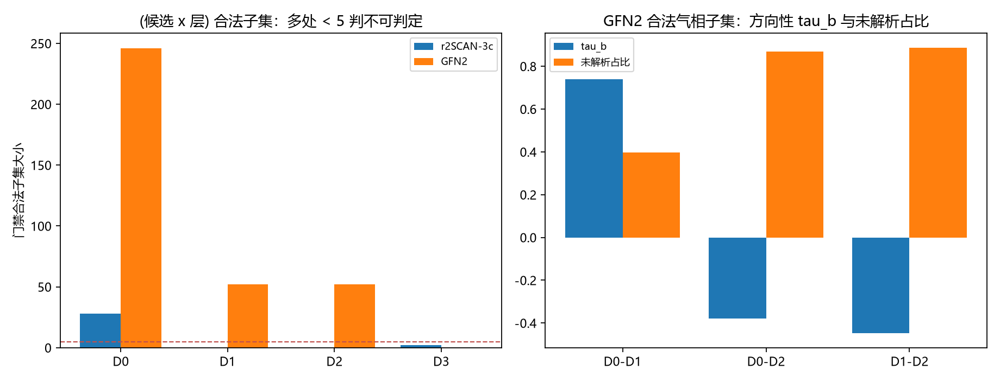

# W46-A 还原轴候选描述符族（不可判定 + 功效下限）

只读主线 lane，0 shot。Lane B 收口：盘上同装置还原锚点 n_anchors = **0** < N_min = 5 ⇒ 主判据不执行，本件产出登记为**不可判定**（与 W33 ORCA 层先例同规格，不算失败）。

## 1 (候选 × 层) 合法子集网格

| 候选 | 层 | 可用 | 合法 | 状态 |
| --- | --- | --- | --- | --- |
| D0 | r2SCAN-3c | 28 | 28 | computable |
| D1 | r2SCAN-3c | 28 | 0 | 不可判定 |
| D2 | r2SCAN-3c | 0 | 0 | 不可判定 |
| D3 | r2SCAN-3c | 28 | 2 | 不可判定 |
| D0 | GFN2 | 246 | 246 | computable |
| D1 | GFN2 | 246 | 52 | computable |
| D2 | GFN2 | 246 | 52 | computable |
| D3 | GFN2 | 0 | 0 | 不可判定 |

## 2 方向性读数（GFN2 合法气相子集）

| 层 | A | B | n | tau_b | 未解析占比(z=1.96) |
| --- | --- | --- | --- | --- | --- |
| GFN2 | D0 | D1 | 48 | 0.7394 | 0.3980 |
| GFN2 | D0 | D2 | 48 | -0.3794 | 0.8697 |
| GFN2 | D1 | D2 | 48 | -0.4486 | 0.8874 |

## 3 功效下限（Lane C）

- Gate 1 的 n = 7：MDE = **0.6541**；功效 tau_true = 0.4 / 0.6 / 0.8 = **0.2300 / 0.6299 / 1.0000**。
- 达到 80% 功效所需锚点数：tau_true = 0.4 / 0.6 / 0.8 → **17 / 8 / 6**。

## 4 判据

| id | 判据 | 值 | 阈 | 判决 |
| --- | --- | --- | --- | --- |
| H46a1 | 主判据（D1/D2/D3 相对 D0 的 Delta tau_b CI 至少一个 > 0）按 H46a2 不执行，登记为不可判定（不判否） | {"executed": false, "verdict": "不可判定", "n_anchors": 0} | {"refusal_branch": "H46a2", "must_not_be_registered_as_negative": true} | 成立 |
| H46a2 | 拒答分支条件：锚点 < N_min = 5 且 n_pairs < 10 | {"n_anchors": 0, "n_pairs_effective": 0, "min_anchors": 5} | {"n_min": 5, "n_pairs_min": 10} | 成立 |
| H46a3 | 层级纪律核验：(候选 × 层) 网格四候选齐全，合法子集不足的格判不可判定，跨层只作对照 | {"grid": {"D0@r2SCAN-3c": "computable", "D1@r2SCAN-3c": "不可判定", "D2@r2SCAN-3c": "不可判定", "D3@r2SCAN-3c": "不可判定", "D0@GFN2": "computable", "D1@GFN2": "computable", "D2@GFN2": "computable", "D3@GFN2": "不可判定"}} | {"same_layer_required": "r2SCAN-3c"} | 成立 |
| H46a4 | 未解析对占比随 tau_b 同报（z = 1.96，二项口径） | {"tau_rows": 3, "unresolved": [0.39805, 0.869681, 0.887411]} | {"unresolved_share_delta_max": 0} | 成立 |
| H46a5 | 功效下限表在位：n = 7 的 MDE 与功效与 Lane C 工具逐位一致（容差 1e-12） | {"n": 7, "mde_at_n7": 0.6540558963871848, "power_tau04": 0.23002645502645513, "power_tau06": 0.6298992673992675, "power_tau08": 1.0, "n_min_tau04": 17, "n_min_tau06": 8, "n_min_tau08": 6} | {"lane_c_source": "w46_taub_power_summary.json"} | 成立 |
| H46a6 | D3（ddCOSMO 溶剂化垂直 EA）未计算状态登记：需新 ORCA 单点，本轮不做 | {"D3_status": ["不可判定", "不可判定"]} | {"must_be_registered": true} | 成立 |
| H46a7 | 方向性读数可复算：GFN2 合法气相子集上 D0/D1/D2 两两 tau_b + 未解析占比 | {"pairs": ["D0-D1", "D0-D2", "D1-D2"], "n": 48} | {"min_legal_subset": 5} | 成立 |
| H46a8 | 输入（Lane A 预注册 + w23/w24/w24_2 + 合法性注册表 + Lane B/C 摘要）sha256 未变 | true | true | 成立 |

> **不可判定**：锚点 0 < 5，主判据（Delta tau_b 的 bootstrap CI）不执行；方向性 tau_b 只作机制读法，不进判决。补足锚点的最小成本见 Lane C（tau_true = 0.6 需 n >= 8 个锚点）。
