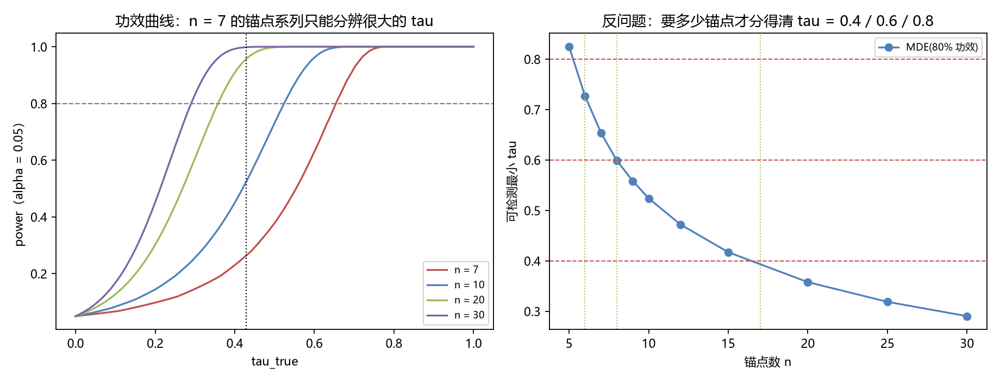

# W46-C tau_b 噪声地板与功效工具化

只读工具 lane；0 shot。把「Gate 1 的阈 0.9 在 n = 7 下意味着什么」算清楚。

## 1 回顾性功效（Gate 1 的 n = 7）

| tau_true | 功效（连续化） | 功效（离散精确） | 过阈 0.9 概率 | 达到 80% 功效所需 n |
| --- | --- | --- | --- | --- |
| 0.4 | 0.2300 | 0.1194 | 0.004365 | 17 |
| 0.6 | 0.6299 | 0.5000 | 0.011434 | 8 |
| 0.8 | 1.0000 | 0.9998 | 0.080903 | 6 |

## 2 反问题：MDE 曲线

| n | 可检测最小 tau（80% 功效） |
| --- | --- |
| 5 | 0.8246 |
| 6 | 0.7271 |
| 7 | 0.6541 |
| 8 | 0.5988 |
| 9 | 0.5584 |
| 10 | 0.5238 |
| 12 | 0.4720 |
| 15 | 0.4171 |
| 20 | 0.3577 |
| 25 | 0.3186 |
| 30 | 0.2903 |

## 3 校准与口径缺口

- 连续化口径 MC 拒绝率（n = 7, tau_true = 0，draws = 200000）：**0.05015**（名义 alpha 0.05）。
- 离散精确口径的 alpha_eff（n = 7）：**0.034524** ⇒ 精确检验在 n = 7 上比名义水平保守 **0.0155**。
- 置换抽样 MC（draws = 100000）：tau_true = 0 时 **0.03412**，tau_true = 0.6 时 **0.49756**。
- 与 W33-B 精确零分布逐点对照：检查 22 个网格点，最大绝对差 **0.000e+00**。
- Gate 1 观测值 0.4285714285714286 的精确单侧 p = **0.119444**，连续化临界值 0.5751 ⇒ 观测值远未过阈。

> 一句话读数：**在 n = 7 上，Gate 1 的 0.9 阈连 tau_true = 0.8 都只有 8.1% 的通过率；要稳定分辨 tau = 0.4 需要约 17 个锚点。** 因此「机制脱节」与「功效不足」必须并列，不能只报前者。

## 4 有限总体地板（R1 闭式，四通道）

| 通道 | s0 | N_pop | sd(N=7) | sd(N=12) | sd(N=30) | Delta tau = 0.15 所需 N |
| --- | --- | --- | --- | --- | --- | --- |
| 介电常数 eps | 0.4737 | 205 | 0.1760 | 0.1327 | 0.0799 | 88.7 |
| 分子轨道 HOMO/LUMO/IP/EA | 0.5828 | 29515 | 0.2203 | 0.1682 | 0.1064 | 234.8 |
| 氧化还原自由能 | 0.3695 | 392 | 0.1384 | 0.1050 | 0.0648 | 76.6 |
| 黏度 eta | 0.4903 | 708 | 0.1844 | 0.1403 | 0.0876 | 135.5 |

## 5 判据

| 判据 | 描述 | 读数 | 阈值 | 结论 |
| --- | --- | --- | --- | --- |
| H46c1 | 校准：n = 7 / tau_true = 0 的连续化蒙特卡洛拒绝率落在 alpha 附近 | 0.050145 | {"window": [0.04, 0.06], "draws": 200000} | 成立 |
| H46c2 | 与 W33-B 精确零分布在 n = 7 上逐点一致（容差 1e-12） | {"max_abs_delta": 0.0, "points": 22, "worst_tau": null} | 1e-12 | 成立 |
| H46c3 | MDE 曲线随 n 单调不增 | {"mde_min": 0.2903027318132423, "mde_max": 0.8245614035087719} | {"tolerance": 1e-12} | 成立 |
| H46c4 | Gate 1 阈 0.9 的回顾性：tau_true = 0.8 时过阈概率 <= 0.15 | 0.0809027777777778 | 0.15 | 成立 |
| H46c5 | alpha 校准（连续化口径）：power(n = 7, tau_true = 0) = alpha | 0.050000000000000024 | {"alpha": 0.05, "tolerance": 1e-09} | 成立 |
| H46c6 | 离散精确口径的保守缺口：alpha_eff(7) < alpha 且缺口 >= 0.01 | {"alpha_effective_discrete": 0.034523809523809526, "gap": 0.015476190476190477} | {"alpha": 0.05, "gap_min": 0.01} | 成立 |
| H46c7 | 置换抽样校准：MC 拒绝率与离散精确值一致（tau_true = 0 与 0.6） | {"mc_tau0": 0.03412, "exact_tau0": 0.034523809523809526, "mc_tau06": 0.49756, "power_discrete_tau06": 0.5} | {"tolerance": 0.005, "draws": 100000} | 成立 |
| H46c8 | 有限总体地板：sd(N) 随 N 单调下降，且四个通道对 Delta tau = 0.15 均可达 | {"channels": 4, "min_required_n_delta_015": 76.55100293554466} | {"min_delta_tau": 0.15} | 成立 |
| H46c9 | Gate 1 的观测 tau 在精确零分布下的单侧 p 可复算且等于预注册值 602/5040 | {"observed_tau": 0.4285714285714286, "observed_p_upper": 0.11944444444444445, "critical_tau_discrete": 0.6190476190476191, "critical_tau_continuous": 0.575091575091575} | {"expected": 0.11944444444444445, "tolerance": 1e-12} | 成立 |
| H46c10 | 输入（prereg + 工具 + W33 工具与摘要 + W32 秩稳定表）sha256 未变 | true | true | 成立 |

## 6 边界

- 只读工具：不接主记分牌、不写标签池或特征列。
- shifted-null 是**预注册的替代模型**，不是物理机制；它只用来量化「n 太小时分不清」。
- 连续化零分布只在网格点之间插值，网格点上取值与精确零分布逐位相同。
- 0 shot；四个冻结读数一个不动。
